# Docker One Shot: Learn Docker from Zero to Full-Stack (with 4 Real Projects)

### Images, containers, volumes, networks, Dockerfile, Docker Compose and Compose Watch — explained simply, then practiced on a Node app, a React app and a full MERN stack.


Have you ever cloned a project, followed the README, and still spent two hours fixing "wrong Node version" or "MongoDB not installed" errors? Docker fixes exactly that.

This post is a **one-shot guide**. First you will understand Docker in plain words. Then you will build and run four real projects, one step at a time. You don't need any Docker experience. If you can run `npm install`, you can follow along.

All the code is in one repo:
👉 **https://github.com/Tanvirulislam345/docker-course**

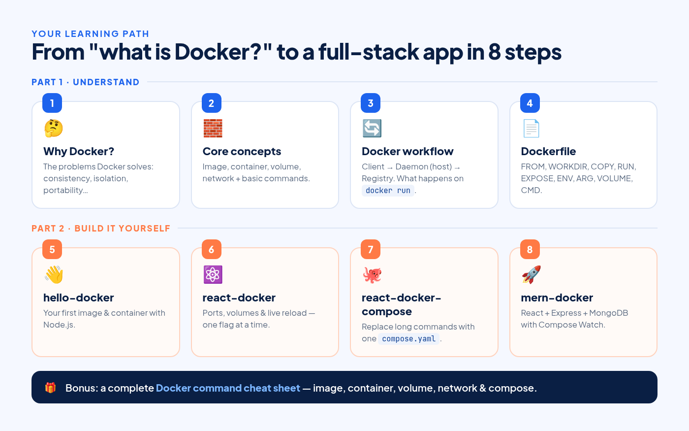

## 📚 Table of Contents

**Part 1 — Understand Docker**

1. Why Docker? The problems it solves
2. Core concepts: image, container, volume, network (+ basic commands)
3. How Docker works: client, host (daemon) and registry
4. The Dockerfile: FROM, WORKDIR, COPY, RUN, EXPOSE, ENV, ARG, VOLUME, CMD

**Part 2 — Build it yourself**

5. Project 1: hello-docker — your first image and container
6. Project 2: react-docker — a React app in Docker
7. Running react-docker step by step: ports, volumes and live reload
8. Docker Compose and Compose Watch
9. Project 3: react-docker-compose
10. Project 4: mern-docker — a full-stack app with Compose Watch
11. Troubleshooting, cheat sheet and wrap-up

**Before you start**, install:

- **Docker Desktop** (Windows/Mac) or **Docker Engine** (Linux): https://docs.docker.com/get-docker/ — Docker Compose comes with it.
- **Git**: https://git-scm.com/

Check that it works:

```bash
docker --version
docker compose version
```

> 💡 `docker compose watch` (used in Project 4) needs Docker Compose **v2.22 or newer**.

---


## 1. Why Docker? The problems it solves

### The "works on my machine" problem

Imagine three developers on one project:

- **You** have Node 22 and MongoDB 7 on Ubuntu. The app works. ✅
- **Your teammate** has Node 18 and MongoDB 5 on Windows. The app crashes. 💥
- **The server** has Node 20 and no MongoDB at all. Deployment fails. 💥

The code is the same everywhere. The **environment** is different. That's the real problem.

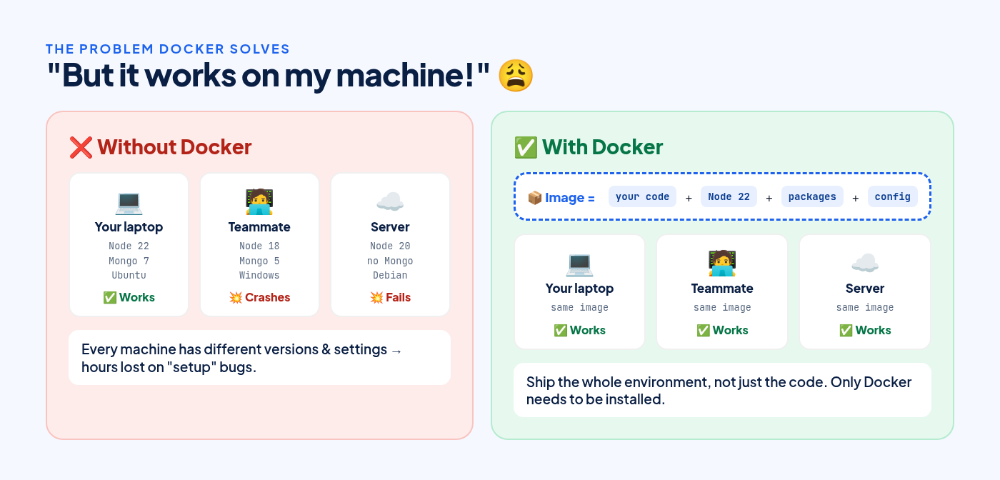

**Docker's idea is simple:** don't ship only your code — ship your code **together with everything it needs to run** (the right Node version, packages, settings). This package is called an **image**. Anyone who has Docker can run that image, and it behaves the same everywhere.

> 🍱 **Analogy:** Instead of giving someone a recipe and hoping they have the same oven and ingredients, you give them a ready-made lunch box. They just open it.

### The 6 problems Docker solves

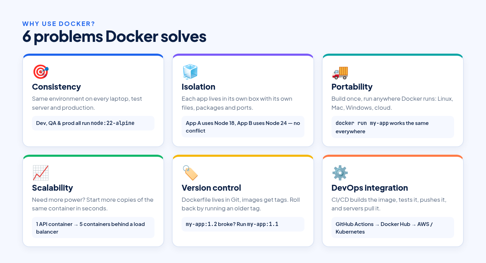

**1. Consistency across environments 🎯**
Development, testing and production all run the **same image**. If it works on your laptop, it works on the server.
*Example:* every environment runs `node:22-alpine`, so nobody hits "this syntax isn't supported in Node 18" bugs.

**2. Isolation 🧊**
Each app runs in its own container with its own files, packages and ports. Apps can't break each other.
*Example:* an old project needs Node 18, a new one needs Node 24. Run both at the same time, no conflict, no `nvm` juggling.

**3. Portability 🚚**
Build once, run anywhere Docker runs: Linux, macOS, Windows, AWS, Azure, Google Cloud.
*Example:* `docker run my-app` works the same on your laptop and on a cloud server.

**4. Scalability 📈**
Need to handle more users? Start more copies of the same container in seconds.
*Example:* 1 API container → 5 API containers behind a load balancer during a sale.

**5. Version control 🏷️**
Your `Dockerfile` is a text file, so it lives in Git like your code. Images get **tags** (`my-app:1.1`, `my-app:1.2`).
*Example:* version 1.2 has a bug? Run `my-app:1.1` again and you're back in minutes.

**6. DevOps integration ⚙️**
Docker is the standard unit of CI/CD. GitHub Actions builds the image, tests it, pushes it to a registry, and servers or Kubernetes pull it.
*Example:* push to `main` → image built automatically → deployed automatically.

### Containers vs virtual machines

You may ask: "Isn't this just a virtual machine?" Not quite.

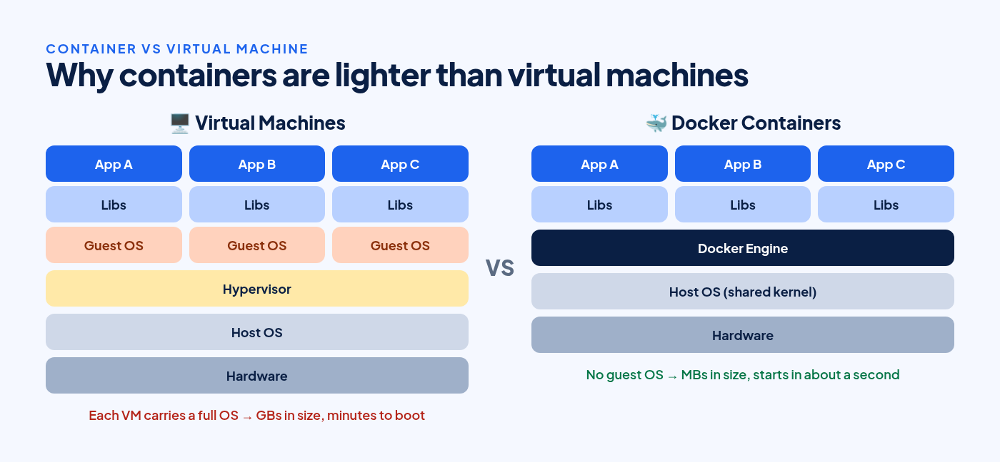

- A **virtual machine** includes a **whole operating system**. It's heavy (GBs) and slow to boot (minutes).
- A **container** **shares the host's OS kernel** and only packs your app and its libraries. It's small (MBs) and starts in about a second.

That's why you can run dozens of containers on a laptop, but only a few VMs.

---


## 2. Core concepts: image, container, volume, network

Docker has four building blocks. Learn these four words and you understand 80% of Docker.

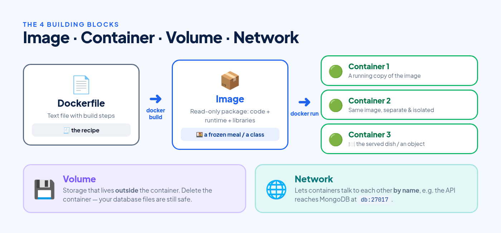

### 📦 Image — the frozen lunch box

An **image** is a read-only package that contains your code, the runtime (e.g. Node.js), the libraries and the start command.

- You **build** an image from a **Dockerfile** (the recipe).
- Or you **download** a ready-made one (like `node`, `mongo`, `nginx`) from Docker Hub.
- Images don't run. They are templates.

> 💡 **Developer analogy:** an image is a **class**, a container is an **object** (an instance of that class).

**Basic image commands:**

```bash
# download an image
docker pull nginx:alpine

# list images on your machine
docker images

# remove one image
docker rmi nginx:alpine

# remove several images at once
docker rmi nginx:alpine mongo hello-docker

# remove all images that no container is using
docker image prune -a
```

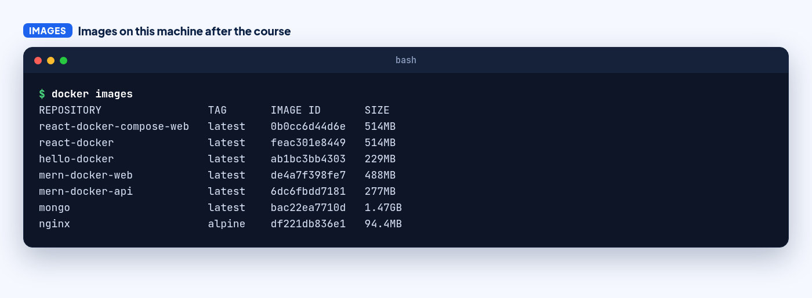

### 🟢 Container — the lunch box you opened

A **container** is a **running copy of an image**. You can start many containers from the same image, and each one is isolated from the others.

- Containers can be **started, stopped, restarted and deleted**.
- Deleting a container does **not** delete the image.

**Basic container commands:**

```bash
# create + start a container in the background, named web1, on port 8080
docker run -d --name web1 -p 8080:80 nginx:alpine

# a second container from the same image
docker run -d --name web2 nginx:alpine

# list running containers (add -a to include stopped ones)
docker ps
docker ps -a

# stop one, or several
docker stop web1
docker stop web1 web2

# remove one, or several (they must be stopped, or use -f)
docker rm web1
docker rm web1 web2

# stop + remove ALL containers
docker rm -f $(docker ps -aq)
```

Here is the real output on my machine:

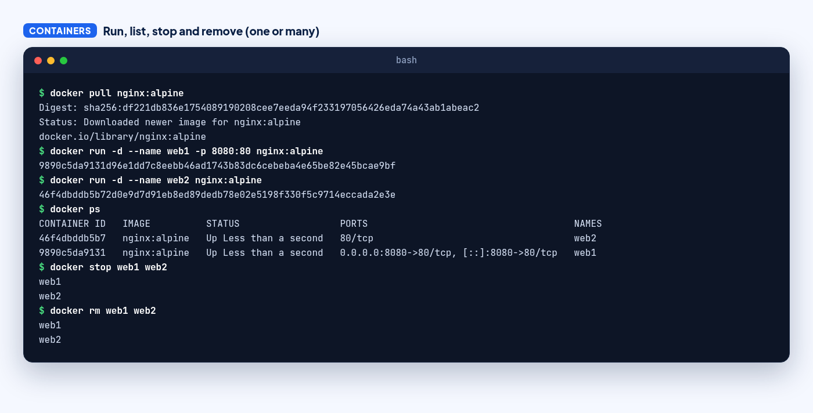

> 💡 You can use a container's **name** (`web1`) or the first few characters of its **ID** (`9890c`) in any command.

### 💾 Volume — the storage that survives

A container's filesystem is **temporary**. When you delete a container, everything written inside it is gone — including your database!

A **volume** is storage that lives **outside** the container. Mount it into the container, and the data survives even if the container is deleted.

**Basic volume commands:**

```bash
# create volumes
docker volume create my-data
docker volume create logs-data

# list volumes
docker volume ls

# see details (where it is stored)
docker volume inspect my-data

# remove one or several volumes
docker volume rm my-data
docker volume rm my-data logs-data

# remove all unused volumes
docker volume prune -a
```

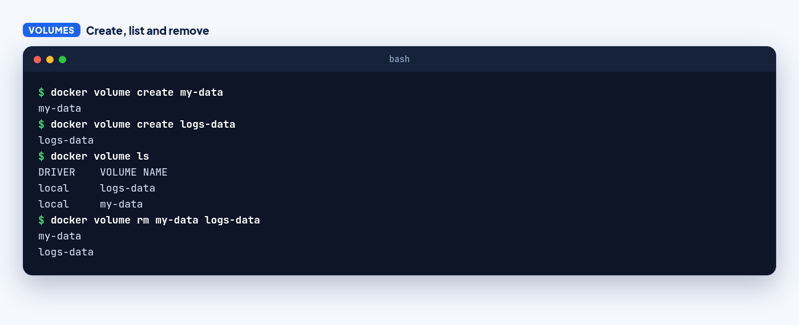

There are three ways to mount storage. You'll use all three in this post:

- **Named volume** — `-v anime:/data/db` → keep database data (Project 4)
- **Bind mount** — `-v "$(pwd):/app"` → mirror your source code for live reload (Project 2)
- **Anonymous volume** — `-v /app/node_modules` → protect a folder from the bind mount (Project 2)

### 🌐 Network — how containers talk

Containers are isolated, so how does your API reach your database? With a **network**. Containers on the same network can reach each other **by name**.

**Basic network commands:**

```bash
# create a network
docker network create my-net

# list networks
docker network ls

# start MongoDB on that network, named "db"
docker run -d --name db --network my-net mongo:latest

# another container on the same network can reach it by name
docker run --rm --network my-net busybox ping -c 2 db

# remove the container and the network
docker rm -f db
docker network rm my-net
```

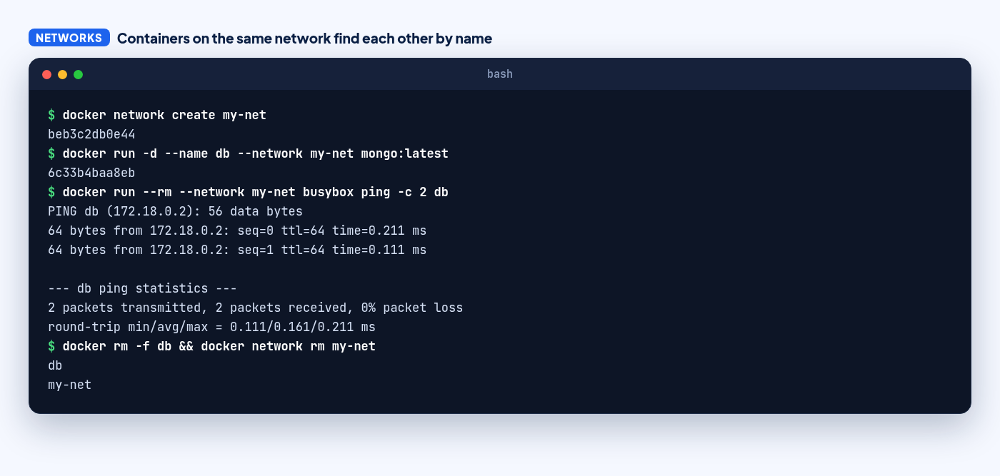

See that? `ping db` worked. Docker turned the name `db` into the container's IP address. You'll use exactly this in Project 4, where the API connects to `mongodb://db/anime`.

> 💡 Docker Compose creates a network for you automatically, so you'll rarely run `docker network create` by hand.

---


## 3. How Docker works: client, host and registry

When you type a Docker command, three parts work together:

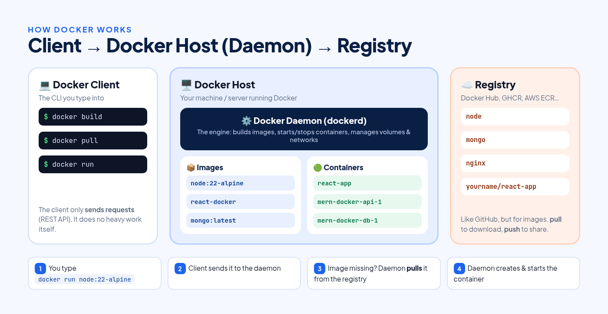

### 💻 Docker Client

The `docker` command you type in the terminal. The client does no heavy work itself. It just **sends your request** to the Docker daemon through an API.

### 🖥️ Docker Host and the Docker Daemon

The **Docker host** is the machine where Docker runs (your laptop or a server). On it runs the **Docker daemon** (`dockerd`) — the engine that does the real work:

- builds images
- creates, starts and stops containers
- manages volumes and networks
- stores images locally

Docker Desktop runs the daemon for you in the background.

### ☁️ Docker Registry

A **registry** is a place to store and share images — like GitHub, but for images. The default one is **Docker Hub** (https://hub.docker.com). Others: GitHub Container Registry, AWS ECR, Google Artifact Registry.

- `docker pull` downloads an image from a registry.
- `docker push` uploads your image to a registry.

### What happens when you run `docker run node:22-alpine`?

1. **You** type the command → the **client** sends it to the **daemon**.
2. The daemon checks: "Do I have `node:22-alpine` locally?"
3. If not, it **pulls** the image from **Docker Hub**.
4. The daemon **creates a container** from the image and **starts** it.

That's the whole Docker workflow: **build → (push/pull) → run**.

---


## 4. The Dockerfile

A **Dockerfile** is a plain text file (named exactly `Dockerfile`, no extension) with step-by-step instructions to build an image. Think of it as the **recipe**.

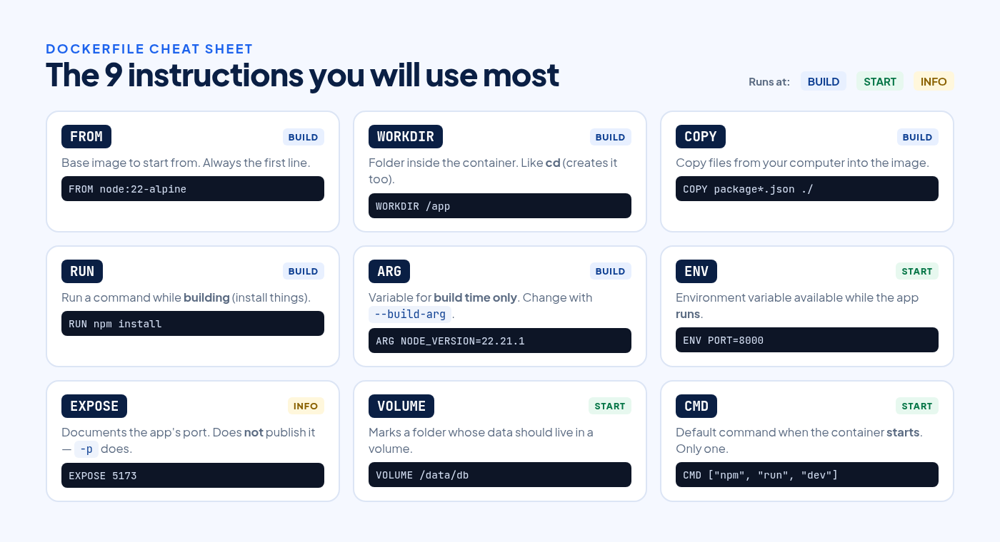

### FROM — choose the base image

Every Dockerfile starts with `FROM`. It's the starting point — usually an OS plus a runtime.

```dockerfile
FROM node:22-alpine
```

`node` is the image name, `22-alpine` is the **tag**: Node.js 22 on **Alpine Linux** (a tiny ~5 MB Linux). Smaller base = faster downloads.

### WORKDIR — set the working folder

Sets the folder inside the image where the next commands run. It creates the folder if it doesn't exist. It's like `cd` (plus `mkdir`).

```dockerfile
WORKDIR /app
```

### COPY — copy files into the image

Copies files from your computer (the **build context**) into the image.

```dockerfile
COPY package*.json ./   # copy package.json and package-lock.json
COPY . .                # copy everything from this folder into /app
```

### RUN — run a command while building

Runs a command **at build time** and saves the result in the image. Use it to install things.

```dockerfile
RUN npm install
```

### EXPOSE — document the port

Tells readers (and tools) which port the app listens on. **It does not open the port by itself** — you still need `-p` when you run the container.

```dockerfile
EXPOSE 5173
```

### ENV — environment variable for the running app

Sets an environment variable that your app can read **while it runs**.

```dockerfile
ENV PORT=8000
```

### ARG — variable for build time only

A variable you can use **only while building**. Change it from the command line with `--build-arg`.

```dockerfile
ARG NODE_VERSION=22.21.1
FROM node:${NODE_VERSION}-alpine
```

```bash
docker build --build-arg NODE_VERSION=20 -t hello-docker .
```

> 💡 **ARG vs ENV:** `ARG` exists only during `docker build`. `ENV` is still there when the container runs.

### VOLUME — mark a folder for persistent data

Tells Docker that this folder holds data that should live in a volume (outside the container's temporary layer).

```dockerfile
VOLUME /data/db
```

> 💡 In practice, you'll usually attach volumes with `-v` or in `compose.yaml` instead, like we do in this post.

### CMD — the start command

The default command that runs **when the container starts**. Only the last `CMD` counts.

```dockerfile
CMD ["npm", "run", "dev"]
```

> 💡 **RUN vs CMD:** `RUN npm install` runs **once, while building** the image. `CMD npm run dev` runs **every time a container starts**.

### Bonus: USER

Our React and MERN Dockerfiles also use `USER`. It switches which user runs the next steps and the app. Running as a normal user instead of `root` is safer: if someone hacks the app, they don't get root access.

### Layers and cache: why the order of lines matters

Each instruction creates a **layer**. Docker caches layers. When you rebuild, Docker reuses every layer until it finds the first one that changed — then it rebuilds that layer **and everything after it**.

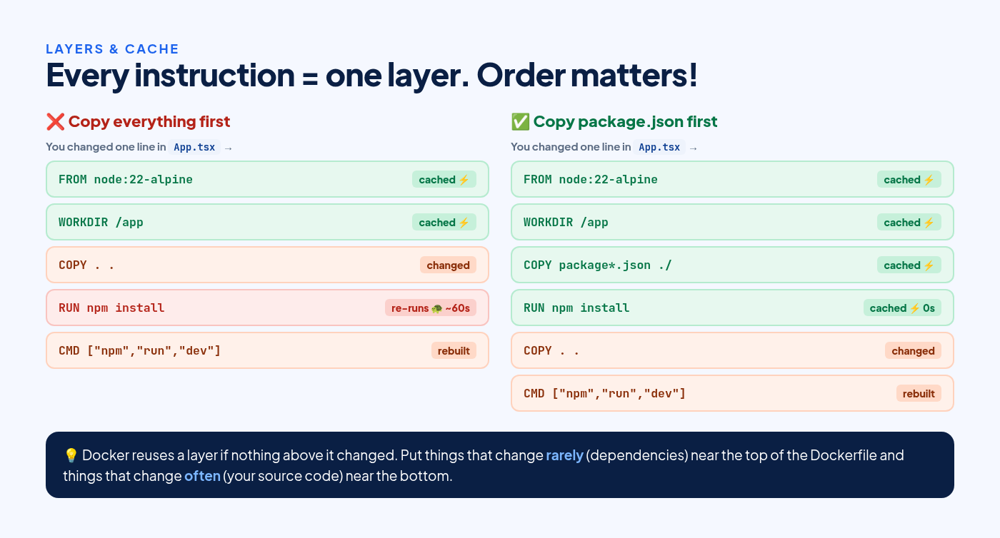

That's why good Dockerfiles copy `package.json` **first**, run `npm install`, and copy the rest of the code **after**. Change a React component → only the last layers rebuild, `npm install` comes from cache. ⚡

### .dockerignore

Like `.gitignore`, but for `docker build`. It keeps files out of the image. All our React projects have one:

```
node_modules/
```

Why? Your local `node_modules` was built for **your** OS. The image needs packages built for **Linux (Alpine)**, so `npm install` runs inside the image instead.

---


## 5. Project 1: hello-docker — your first image and container

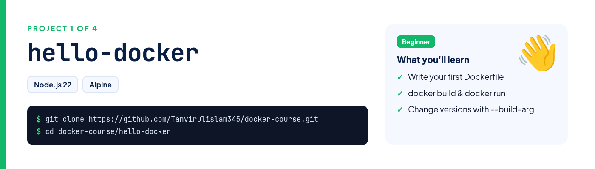

The simplest possible app: one line of Node.js.

### Step 1: Clone the repo

```bash
git clone https://github.com/Tanvirulislam345/docker-course.git
cd docker-course/hello-docker
```

### Step 2: Look at the code

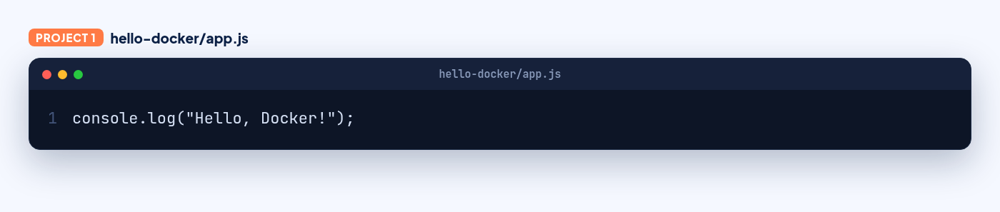

### Step 3: Read the Dockerfile

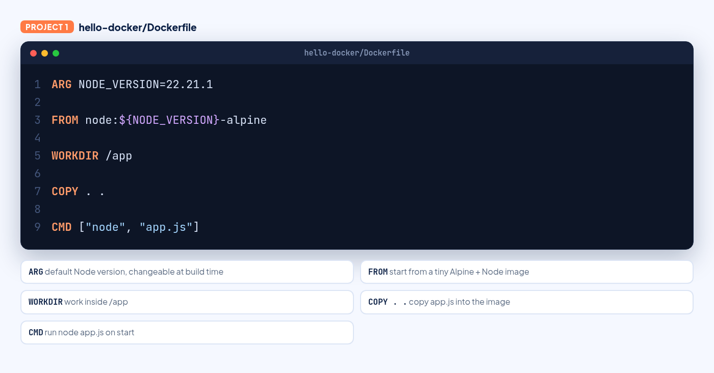

Line by line:

- `ARG NODE_VERSION=22.21.1` — a build-time variable with a default Node version.
- `FROM node:${NODE_VERSION}-alpine` — start from the official Node image on Alpine Linux.
- `WORKDIR /app` — work inside `/app` in the image.
- `COPY . .` — copy everything from this folder (`app.js`, …) into `/app`.
- `CMD ["node", "app.js"]` — when a container starts, run `node app.js`.

### Step 4: Build the image

```bash
docker build -t hello-docker .
```

- `docker build` — build an image from a Dockerfile.
- `-t hello-docker` — **t**ag (name) the image `hello-docker`.
- `.` — the **build context**: use the current folder (Docker looks for the `Dockerfile` here).

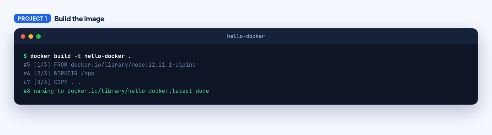

You can see the three steps from the Dockerfile: `[1/3] FROM`, `[2/3] WORKDIR`, `[3/3] COPY`.

### Step 5: Run the container

```bash
docker run --rm hello-docker
```

- `docker run` — create and start a container from the image.
- `--rm` — delete the container automatically when it stops. The app prints one line and exits, so we don't need to keep it.

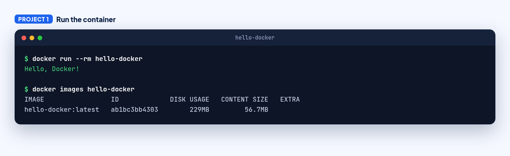

🎉 **Congratulations — you just ran your first container!** Notice: you didn't need Node.js installed on your computer. It came inside the image.

### Step 6 (optional): Use a different Node version

Because the Dockerfile uses `ARG`, you can build with another Node version without editing any file:

```bash
docker build --build-arg NODE_VERSION=20 -t hello-docker .
docker run --rm hello-docker
```

### Clean up

```bash
docker images              # list images
docker rmi hello-docker    # remove the image
```

---

## 6. Project 2: react-docker — a React app in Docker

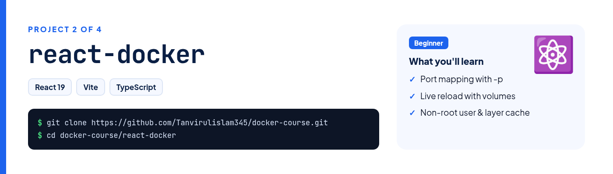

Now a real frontend: **React 19 + TypeScript + Vite**. This one is a web server, so you'll learn about **ports** and **volumes**.

### Step 1: Go to the project

```bash
cd ../react-docker      # or: git clone … && cd docker-course/react-docker
```

### Step 2: ⚠️ Important — add `--host` to the dev script

Open `package.json`. The `dev` script must be `vite --host`, not just `vite`:

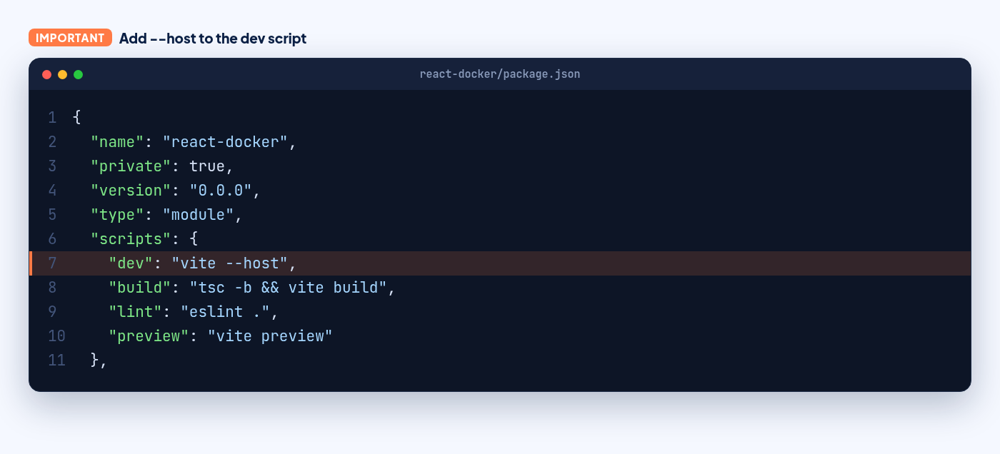

> ⚠️ **Why is this needed?** By default, Vite listens only on `localhost` **inside the container**. Requests from your browser come from **outside** the container, so Vite ignores them and the page never loads. `--host` makes Vite listen on all network interfaces (`0.0.0.0`), so Docker can forward your browser's requests to it.
>
> In your own projects, change `"dev": "vite"` to `"dev": "vite --host"` (or set `server: { host: true }` in `vite.config.js`). The repo already has this.

### Step 3: Read the Dockerfile

The file in the repo has a comment on every line. Here it is without comments:

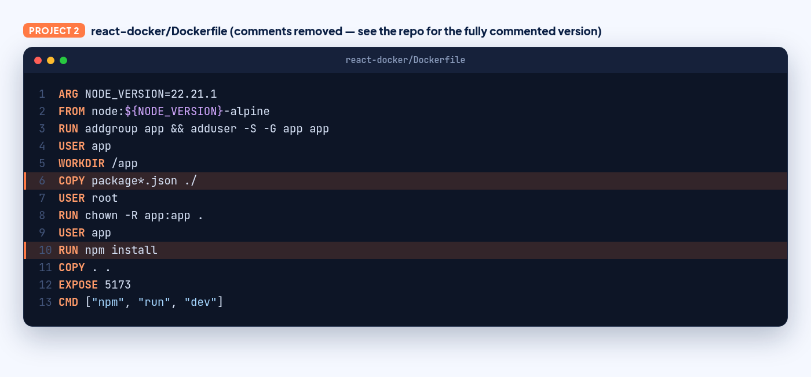

What each part does, in plain words:

1. **`ARG` + `FROM`** — start from Node 22 on Alpine.
2. **`RUN addgroup app && adduser -S -G app app`** — create a normal user called `app` (`-S` = system user, `-G app` = put it in the `app` group).
3. **`USER app`** — from now on, run as `app`, not `root`. Safer.
4. **`WORKDIR /app`** — work in `/app`.
5. **`COPY package*.json ./`** — copy **only** `package.json` and `package-lock.json` first (highlighted). This is the cache trick from section 4: if these files don't change, the slow `npm install` step is reused from cache.
6. **`USER root` → `RUN chown -R app:app .` → `USER app`** — `WORKDIR` and `COPY` create files owned by `root`, so the `app` user can't write to `/app` and `npm install` fails with `EACCES: permission denied`. We switch to root for a moment, give the folder to `app`, then switch back.
7. **`RUN npm install`** — install dependencies **inside the image** (Linux versions of the packages).
8. **`COPY . .`** — now copy the rest of the source code.
9. **`EXPOSE 5173`** — document that Vite uses port 5173.
10. **`CMD ["npm", "run", "dev"]`** — start the Vite dev server when the container starts.

---

## 7. Running react-docker step by step

Let's add **one flag at a time**, so you see exactly what each one does. Here's the whole journey at a glance:

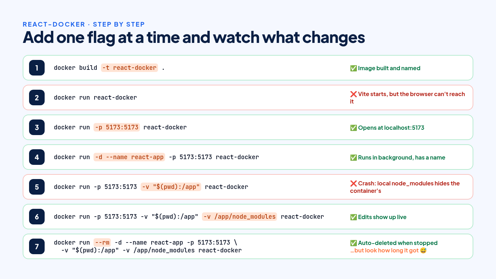

### Step 1 — Build the image

```bash
docker build -t react-docker .
```

The first build takes a minute (it runs `npm install`). Builds after that are much faster thanks to the cache.

### Step 2 — Run it (and see it fail 🤔)

```bash
docker run react-docker
```

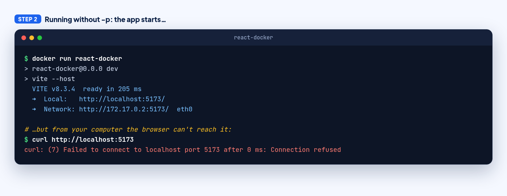

Vite says it's ready at `http://localhost:5173`… but open that in your browser and **nothing loads**. Why?

The container has its **own network**. Port 5173 is open **inside the container**, but nobody connected it to your computer. Press `Ctrl + C` to stop it.

### Step 3 — Add port mapping: `-p`

```bash
docker run -p 5173:5173 react-docker
```

Open **http://localhost:5173** — 🎉 the React app loads!

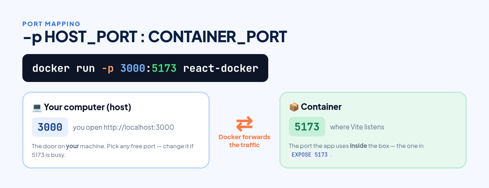

`-p HOST_PORT:CONTAINER_PORT` connects a port on your computer to a port in the container.

- The **right** number must match where the app listens (5173 for Vite).
- The **left** number can be anything free. Port 5173 busy? Use `-p 3000:5173` and open http://localhost:3000.

### Step 4 — Run in the background with a name: `-d --name`

Your terminal was blocked by the logs. Let's run it in the background and give it a name:

```bash
docker run -d -p 5173:5173 --name react-app react-docker
```

- `-d` — **detached**: run in the background and give you your terminal back.
- `--name react-app` — a friendly name, so you don't have to copy IDs.

Now manage it with:

```bash
docker ps                # is it running?
docker logs react-app    # what did it print?
docker logs -f react-app # follow the logs live (Ctrl+C to exit)
docker stop react-app    # stop it
docker rm react-app      # remove it
```

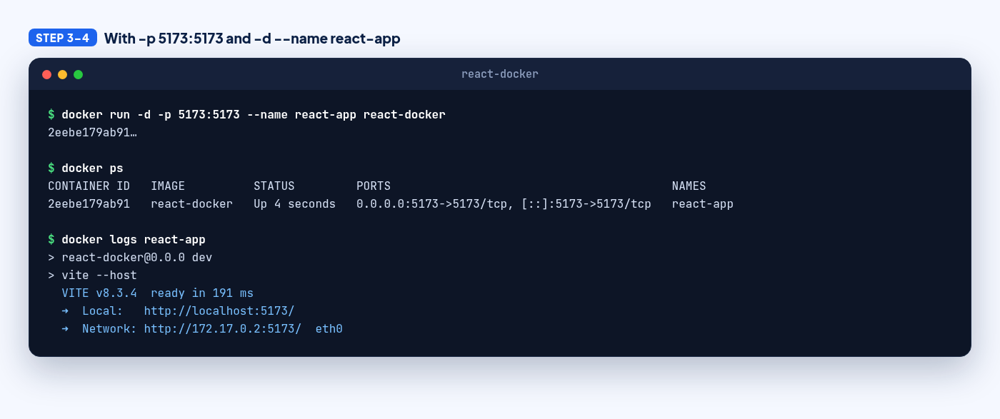

### Step 5 — Sync your code with a volume: `-v`

Change some text in `src/App.tsx` and refresh the browser. **Nothing changes.** Why? Your code was **copied into the image** at build time. The container doesn't see your edits. Rebuilding the image for every change would be painful.

The fix is a **bind mount**: mirror your project folder into the container's `/app`.

```bash
docker stop react-app && docker rm react-app
docker run -p 5173:5173 -v "$(pwd):/app" react-docker
```

- `-v "$(pwd):/app"` — mount the current folder (`$(pwd)`) onto `/app` in the container.

But… it **crashes**:

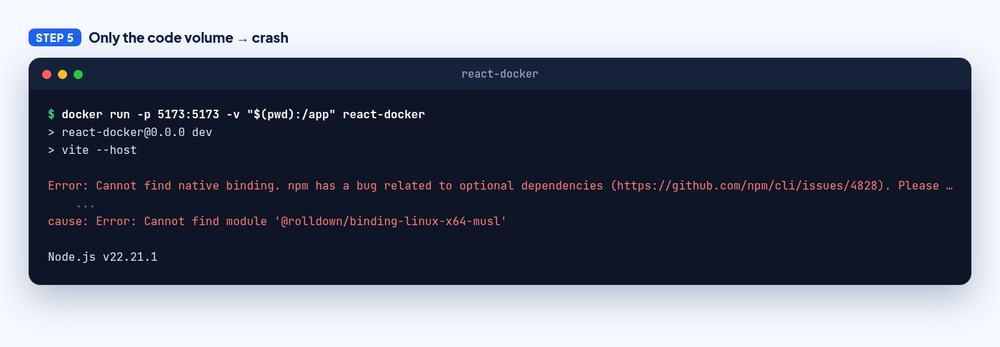

**What happened?** The bind mount **replaced** the whole `/app` folder with your local folder — including `node_modules`. The container's Linux packages are now hidden behind your local ones (built for your OS, or missing entirely if you never ran `npm install`). Vite can't find what it needs.

### Step 6 — Protect node_modules: `-v /app/node_modules`

```bash
docker run -p 5173:5173 -v "$(pwd):/app" -v /app/node_modules react-docker
```

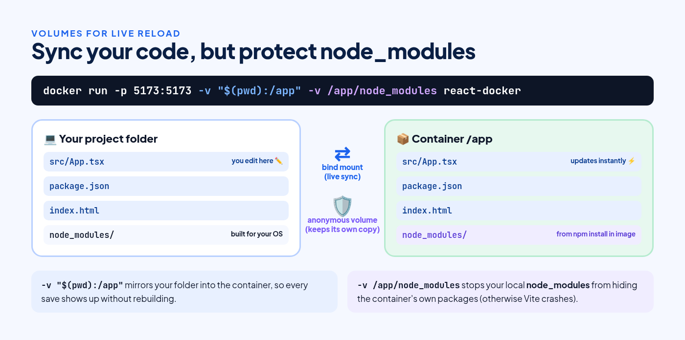

The second `-v /app/node_modules` is an **anonymous volume**. It tells Docker: "for this one folder, keep the container's own copy, don't take it from my computer". Your source code syncs, the container's packages stay.

> 🪟 **Windows users:** use `${PWD}` in PowerShell or `%cd%` in Command Prompt instead of `$(pwd)`.

### Step 7 — Edit and refresh 🔄

Now edit `src/App.tsx` (for example change the "Get started" heading) and save. The browser updates by itself — Vite's hot reload works inside Docker:

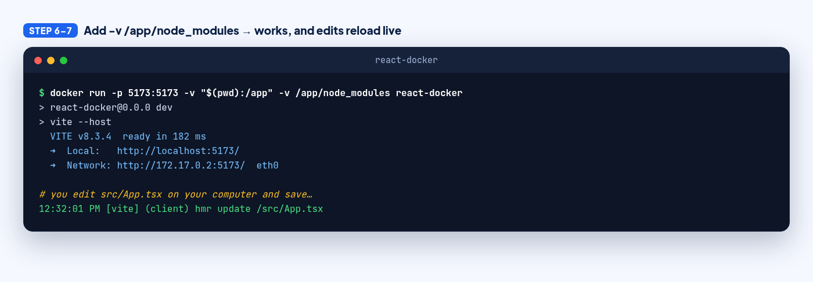

> 💡 **Edits not showing up?** On some Windows/Mac setups, file-change events don't reach the container. Turn on polling in `vite.config.ts`: `server: { watch: { usePolling: true } }`. Project 4 already does this.

### Step 8 — Clean up automatically: `--rm`

Add `--rm` so the container deletes itself when stopped, and `-d --name` to run in the background:

```bash
docker run --rm -d --name react-app -p 5173:5173 \
  -v "$(pwd):/app" -v /app/node_modules react-docker
```

Stop it any time with `docker stop react-app` — no `docker rm` needed.

### …but look how long that command got 😅

You need to remember **five flags**, type them every time, and share them with your team in a README. Now imagine a frontend **plus** a backend **plus** a database. That's the problem **Docker Compose** solves.

---


## 8. Docker Compose and Compose Watch

### What is Docker Compose?

**Docker Compose** lets you describe your containers in a YAML file (`compose.yaml`) and start them all with **one command**: `docker compose up`.

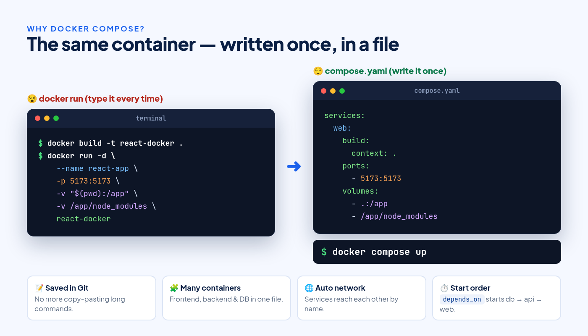

### Which problems does Compose solve?

- **Long commands** → written once in a file, saved in Git. No more copy-pasting flags.
- **Many containers** → frontend, backend and database in the same file, started together.
- **Networking** → Compose creates a network automatically. Services find each other **by service name** (`db`, `api`).
- **Start order** → `depends_on` starts the database before the API, and the API before the frontend.
- **One command for everything** → `up`, `down`, `logs`, `ps` work for the whole app.

### Compose components

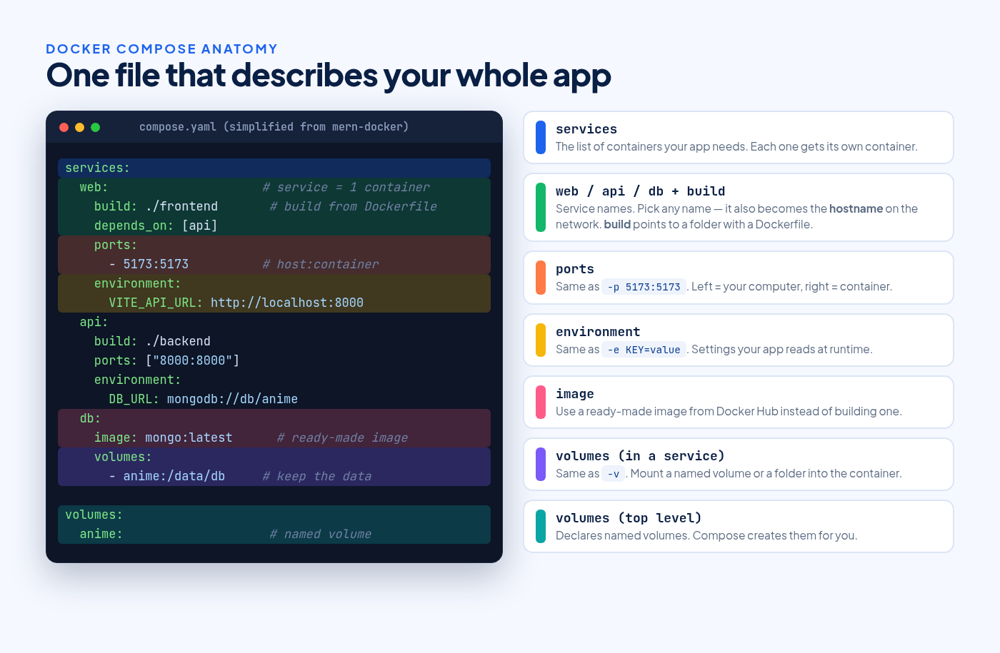

- **`services`** — the list of containers your app needs. Each service becomes one container.
- **Service name** (`web`, `api`, `db`) — any name you like. It also becomes the **hostname** on the Compose network.
- **`build`** — build the image from a folder that has a Dockerfile (like `docker build`).
- **`image`** — or use a ready-made image from Docker Hub (like `docker pull`).
- **`ports`** — same as `-p`: `"HOST:CONTAINER"`.
- **`environment`** — same as `-e`: environment variables for the app.
- **`volumes`** (inside a service) — same as `-v`: mount a named volume or a folder.
- **`volumes`** (top level) — declare named volumes; Compose creates them for you.
- **`depends_on`** — start other services first.
- **`develop.watch`** — rules for Compose Watch (below).

### The everyday Compose commands

```bash
docker compose up             # build if needed, create and start everything
docker compose up --build     # force a rebuild first
docker compose up -d          # run in the background
docker compose ps             # list this project's containers
docker compose logs -f web    # follow one service's logs
docker compose stop           # stop, but keep the containers
docker compose down           # stop and remove containers + network
docker compose down -v        # …and delete the volumes too (⚠️ data!)
```

### What is Compose Watch, and why do we need it?

With plain `docker compose up`, the image contains a **copy** of your code. Change a file → you must stop, `up --build` again, and wait. Every. Single. Time.

Bind mounts (what we did in Project 2) help, but they have problems:

- They share **everything**, including `node_modules`, so you need tricks like the anonymous volume.
- On Mac and Windows, bind mounts can be slow.
- When you add an npm package, a bind mount doesn't install it — you have to rebuild by hand.

**`docker compose watch`** fixes this. You tell Compose **which files to watch** and **what to do** when they change:

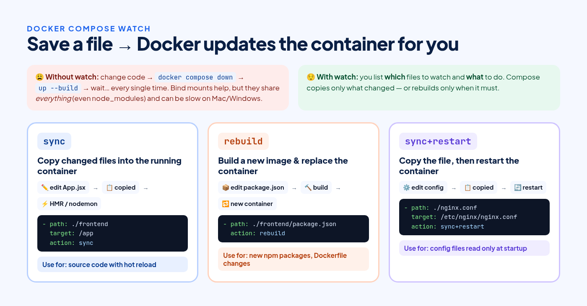

- **`sync`** — copy the changed files into the running container. Your app's own hot reload (Vite, nodemon) picks them up. **Use for source code.**
- **`rebuild`** — build a new image and replace the container. **Use for `package.json`, lock files and the Dockerfile** (new packages get installed).
- **`sync+restart`** — copy the files, then restart the container. **Use for config files** that the app reads only at startup.

You'll use Compose Watch in Project 4.

---


## 9. Project 3: react-docker-compose

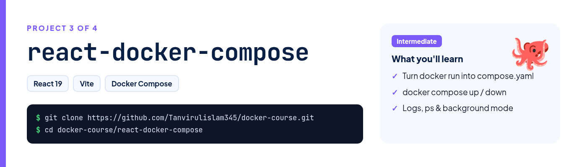

The same React app as Project 2 (same Dockerfile, same `vite --host` dev script) — but now we run it with Compose.

### Step 1: Go to the project

```bash
cd ../react-docker-compose
```

### Step 2: Read compose.yaml

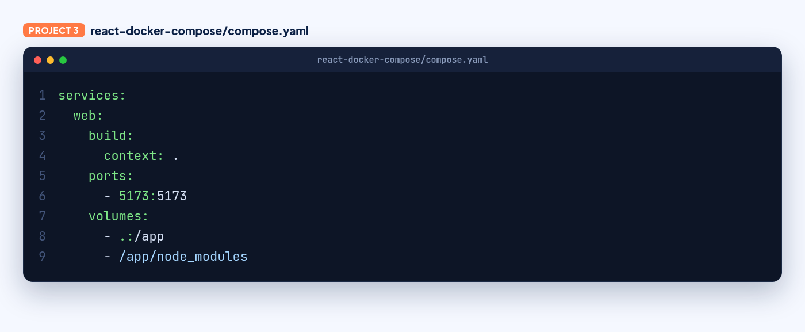

Compare it with the long command from Project 2 — it's the same thing, written as a file:

- `services:` → `web:` — one service named `web`.
- `build: context: .` — build the image from the Dockerfile in this folder (`docker build .`).
- `ports: - 5173:5173` — same as `-p 5173:5173`.
- `volumes: - .:/app` — same as `-v "$(pwd):/app"` (sync the code).
- `volumes: - /app/node_modules` — same as `-v /app/node_modules` (protect packages).

### Step 3: Start it

```bash
docker compose up --build
```

`--build` builds the image first. Open **http://localhost:5173**. Edit `src/App.tsx` — the page updates live, because of the volumes in `compose.yaml`.

Or run it in the background:

```bash
docker compose up -d --build
```

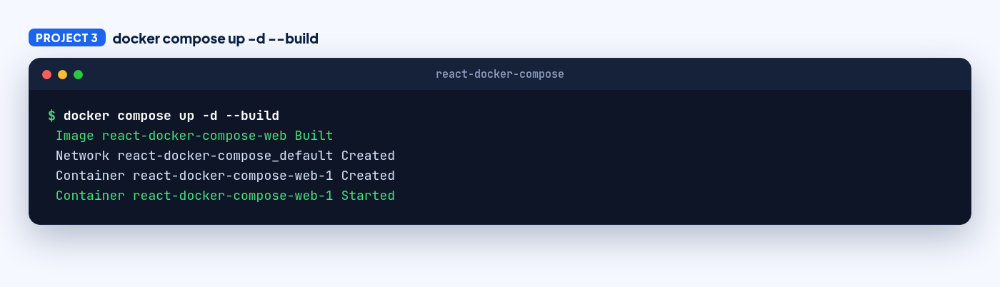

Notice that Compose created a **network** (`react-docker-compose_default`) and a **container** (`react-docker-compose-web-1`) with names based on the folder and service.

### Step 4: Check status and logs

```bash
docker compose ps
docker compose logs -f web
```

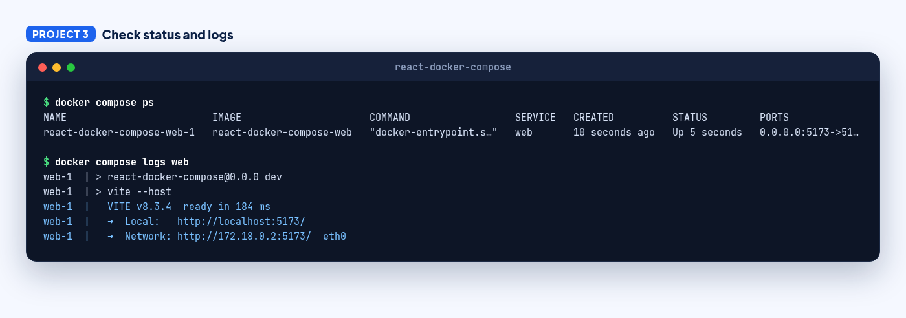

### Step 5: Stop and clean up

```bash
docker compose down
```

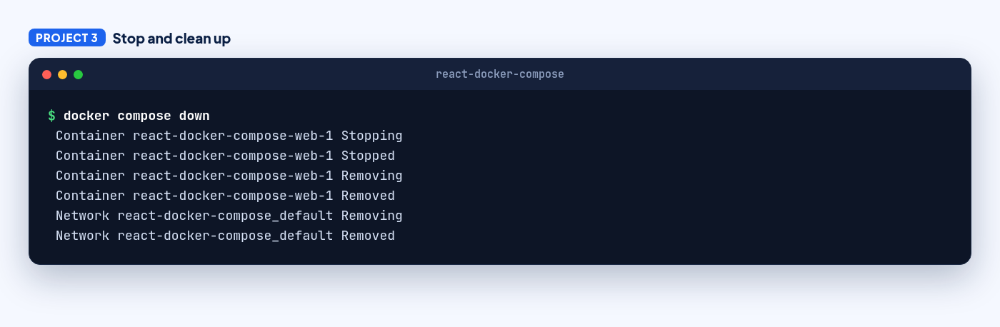

One command removed the container **and** the network.

> ⚠️ **Added a new npm package and it's "missing" in the container?** The `/app/node_modules` volume still holds the old packages. Run `docker compose down -v` (removes that volume), then `docker compose up --build`.

---

## 10. Project 4: mern-docker — a full-stack app with Compose Watch

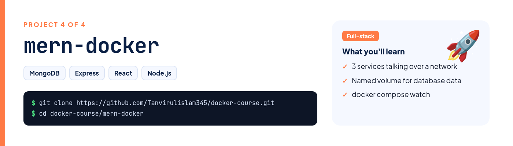

Time for the real thing: an **Anime sharing app** built with **MongoDB, Express, React and Node.js** (MERN). Three containers, one command.

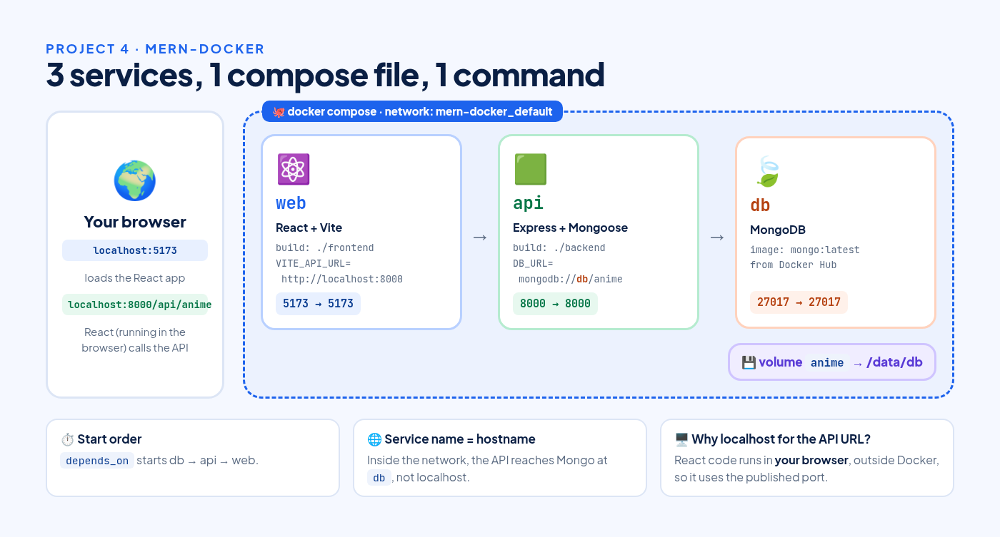

- **`web`** — React + Vite frontend, built from `./frontend`, port **5173**. Pages: Home (`/`) lists all anime, Share (`/create`) adds one.
- **`api`** — Express 5 + Mongoose backend, built from `./backend`, port **8000**. Endpoints: `GET /api/anime`, `POST /api/anime`.
- **`db`** — MongoDB from the official `mongo:latest` image, port **27017**, data stored in the named volume **`anime`**.

### Step 1: Go to the project

```bash
cd ../mern-docker      # or: git clone … && cd docker-course/mern-docker
```

### Step 2: The Dockerfiles

Both `backend/Dockerfile` and `frontend/Dockerfile` follow the same pattern you already know from Project 2 (non-root user, copy `package*.json` first, install, copy code). Two small differences:

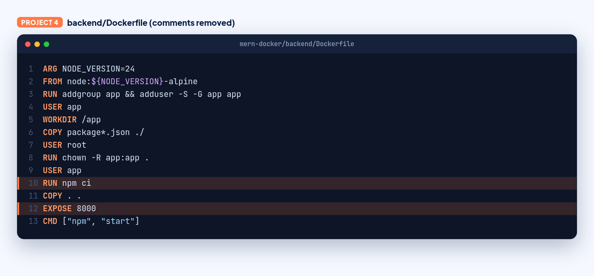

- **`npm ci`** instead of `npm install` — installs **exactly** the versions in `package-lock.json`. Faster and more reliable for builds.
- **`EXPOSE 8000`** and `CMD ["npm", "start"]` for the backend, which runs `nodemon index.js` (restarts the server when files change).

### Step 3: Read compose.yaml

The repo's `compose.yaml` has a comment on every line. Here it is without comments (the Compose Watch rules are highlighted):

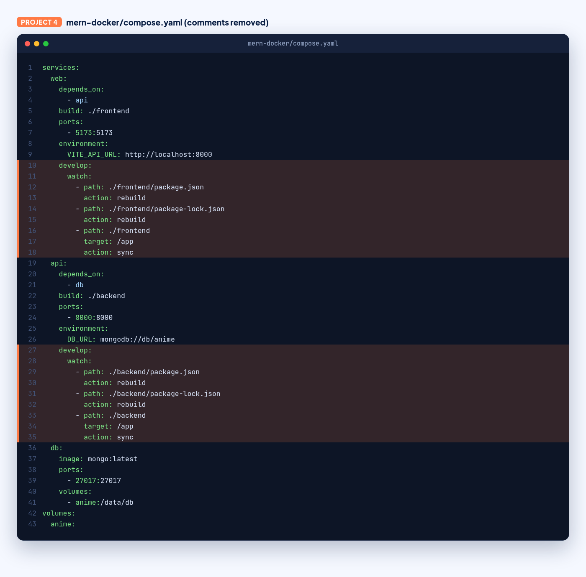

Service by service:

**`web` (frontend)**
- `depends_on: - api` — start the API first.
- `build: ./frontend` — build from `frontend/Dockerfile`.
- `ports: - 5173:5173` — open the app at http://localhost:5173.
- `environment: VITE_API_URL: http://localhost:8000` — where React sends API requests.
- `develop.watch` — `rebuild` when `package.json` / `package-lock.json` change, `sync` the `./frontend` folder into `/app` for everything else.

**`api` (backend)**
- `depends_on: - db` — start MongoDB first.
- `build: ./backend`, `ports: - 8000:8000`.
- `environment: DB_URL: mongodb://db/anime` — connect to the database.
- `develop.watch` — same idea: `rebuild` on package changes, `sync` the code.

**`db` (database)**
- `image: mongo:latest` — no Dockerfile needed; use the official image from Docker Hub.
- `ports: - 27017:27017` — lets you connect from your computer with a tool like MongoDB Compass.
- `volumes: - anime:/data/db` — MongoDB stores its files in `/data/db`; we put that in the named volume `anime`.

**Top-level `volumes: anime:`** — declares the named volume. Compose creates it as `mern-docker_anime`.

### 🔑 Two lines that confuse everyone

**1. Why `mongodb://db/anime` and not `localhost`?**
The API runs **inside** a container. For that container, `localhost` means **itself**, not MongoDB. On the Compose network, each **service name is a hostname**, so `db` points to the MongoDB container.

**2. Then why is `VITE_API_URL` `http://localhost:8000`?**
Because React code doesn't run in the `web` container — it runs **in your browser**, on your computer, outside Docker. From your computer, the API is reachable at the published port `localhost:8000`.

> 💡 **Rule of thumb:** container → container = **service name**. Browser → container = **localhost + published port**.

### Step 4: Start the whole stack

```bash
docker compose up --build
```

Or in the background:

```bash
docker compose up -d --build
```

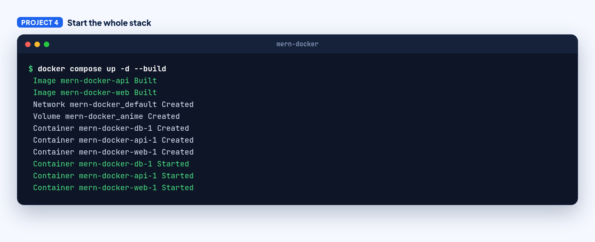

Look at the order: `db` started first, then `api`, then `web` — that's `depends_on` at work. Compose also created the network and the `anime` volume.

Open:

- Frontend: **http://localhost:5173**
- API: **http://localhost:8000/api/anime**

```bash
docker compose ps
docker compose logs api
```

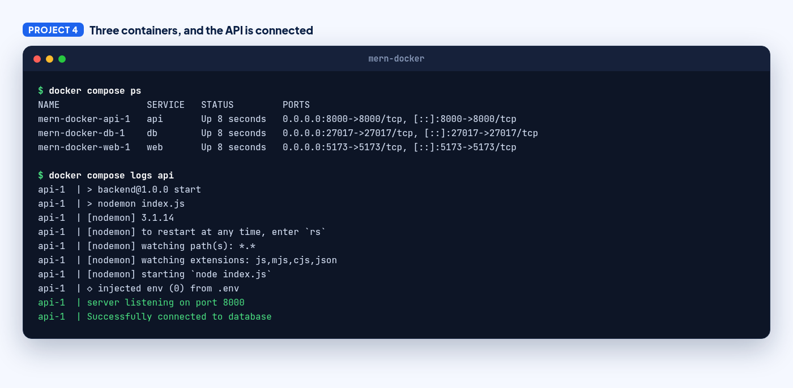

`Successfully connected to database` — the API found MongoDB by its service name `db`. 🎉

### Step 5: Add some data

Use the **Share** page in the browser, or call the API directly:

```bash
curl -X POST http://localhost:8000/api/anime \
  -H "Content-Type: application/json" \
  -d '{"title": "Naruto", "description": "A ninja story"}'

curl http://localhost:8000/api/anime
```

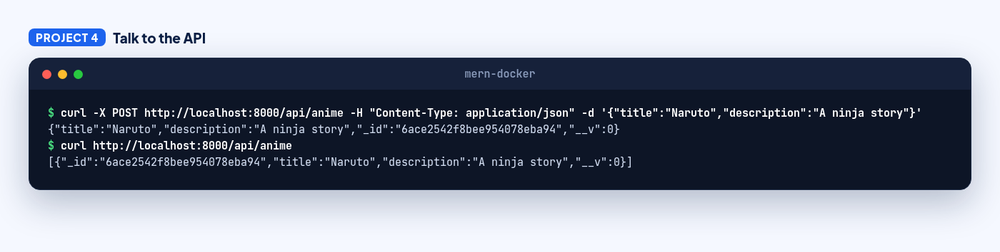

### Step 6: Does the data survive? (volumes in action)

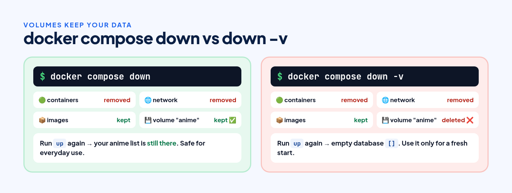

```bash
docker compose down     # remove containers + network
docker compose up -d    # start again
curl http://localhost:8000/api/anime
```

Naruto is **still there**, because MongoDB's data lives in the `anime` volume, not in the container.

Now try with `-v`:

```bash
docker compose down -v  # also delete volumes
docker compose up -d
curl http://localhost:8000/api/anime
```

The list is **empty** (`[]`). `-v` deleted the volume and all the data.

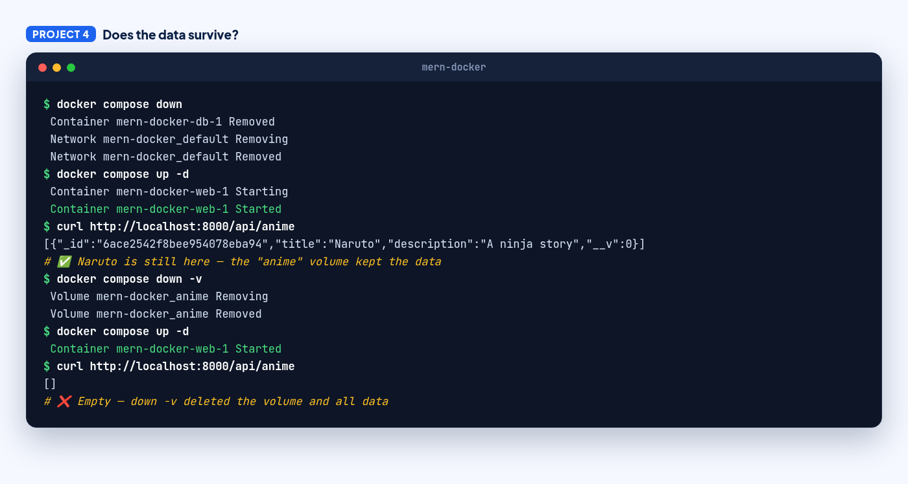

> ⚠️ Use `docker compose down` every day. Use `docker compose down -v` only when you really want a fresh, empty database.

### Step 7: Live development with Compose Watch

Stop the stack and start it in watch mode:

```bash
docker compose down
docker compose watch
```

Now edit `backend/index.js` — for example change `res.send("Hello World!")` to `res.send("Hello from Docker Compose Watch!")` — and save:

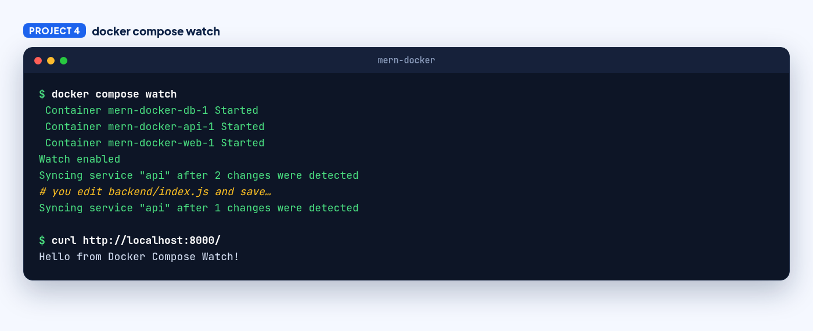

1. Compose saw the change and **synced** the file into the `api` container ("Syncing service "api"…").
2. `nodemon` inside the container noticed it and restarted the server.
3. `curl http://localhost:8000/` returns the new text — **no rebuild, no restart by hand.**

The same works for the frontend: edit a React component and the browser updates. And if you add a package (`npm install axios` changes `package.json`), Compose **rebuilds** the image for you.

> 💡 **Why does the frontend need `usePolling`?** Files synced into a container don't always trigger the file-change events Vite listens for. `watch: { usePolling: true }` makes Vite check for changes regularly, so it always notices synced files. `host: true` does the same job as `vite --host`.

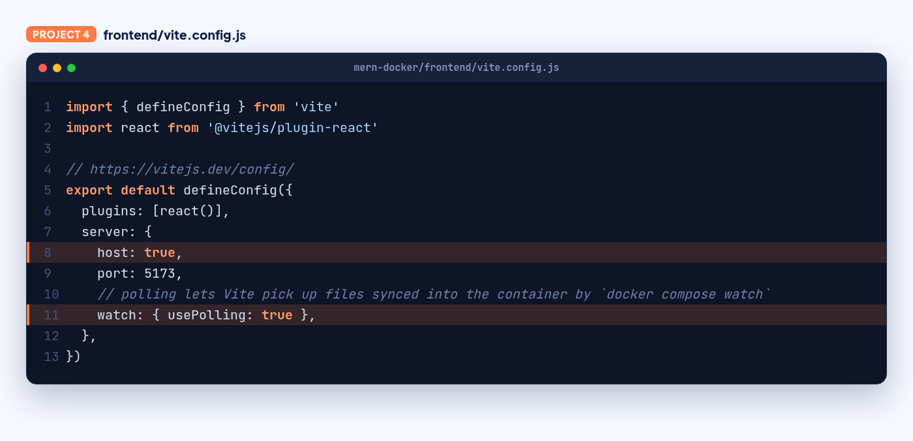

Press `Ctrl + C` to stop watching, then `docker compose down`.

### Bonus: run only the database in Docker

Want to run the backend and frontend with plain `npm` but skip installing MongoDB? Start only the `db` service:

```bash
docker compose up -d db
```

Now MongoDB is available at `mongodb://localhost:27017/anime` for your local Node app. Docker is useful even when you don't containerize everything.

---


## 11. Troubleshooting, cheat sheet and wrap-up

### Common errors and quick fixes

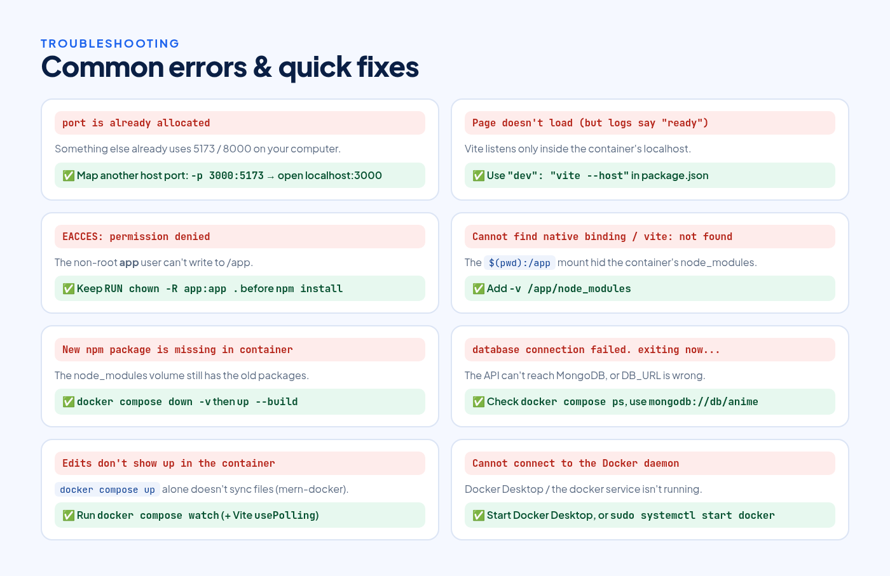

- **`port is already allocated`** — another app uses that port. Map a different host port: `-p 3000:5173`, then open http://localhost:3000.
- **Page doesn't load, but the logs say "ready"** — Vite is listening only inside the container. Use `"dev": "vite --host"`.
- **`EACCES: permission denied`** — the non-root `app` user can't write to `/app`. Keep `RUN chown -R app:app .` before `npm install` / `npm ci`.
- **`Cannot find native binding` / `vite: not found`** — your bind mount hid the container's `node_modules`. Add `-v /app/node_modules`.
- **New npm package missing in the container** — `docker compose down -v`, then `docker compose up --build`.
- **`database connection failed. exiting now...`** — the API can't reach MongoDB. Check `docker compose ps` and that `DB_URL` is `mongodb://db/anime`, then `docker compose restart api`.
- **Edits don't show up (mern-docker)** — `docker compose up` alone doesn't sync files. Use `docker compose watch`.
- **`Cannot connect to the Docker daemon`** — Docker isn't running. Start Docker Desktop, or `sudo systemctl start docker` on Linux.

### 📋 The complete Docker command cheat sheet

I put every command you'll need — **image-wise, container-wise, volume-wise, network-wise**, plus Dockerfile builds, Docker Compose, registry and cleanup — in one page:

👉 **[Docker Commands Cheat Sheet](https://github.com/Tanvirulislam345/docker-course/blob/main/docker-commands-cheatsheet.md)**

Bookmark it. You'll use it every day.

### What you learned

- **Why Docker:** consistency, isolation, portability, scalability, version control and DevOps integration.
- **The four building blocks:** images (the recipe result), containers (running copies), volumes (data that survives) and networks (containers talking by name).
- **How Docker works:** the client sends commands, the daemon does the work, the registry stores images.
- **The Dockerfile:** FROM, WORKDIR, COPY, RUN, EXPOSE, ENV, ARG, VOLUME, CMD — and why order matters for caching.
- **`docker run` flags:** `-p` for ports, `-d` and `--name`, `-v` for live code sync, `-v /app/node_modules` to protect packages, `--rm` for auto-cleanup.
- **Docker Compose:** one `compose.yaml` instead of long commands; services, ports, volumes, environment, depends_on.
- **Compose Watch:** `sync`, `rebuild` and `sync+restart` for a smooth dev loop.
- **A full MERN stack** running with one command.

### Where to go next

- **Multi-stage builds** — build React into static files and serve them with Nginx for a tiny production image.
- **Push your image to Docker Hub** — `docker tag` + `docker push`, then `docker pull` it on a server.
- **CI/CD** — build and push images automatically with GitHub Actions.
- **Kubernetes** — run and scale containers across many machines.

### The code

Everything in this post is here — clone it, break it, fix it:
👉 **https://github.com/Tanvirulislam345/docker-course**

If this helped you, give it a 👏 on Medium, star ⭐ the repo, and share it with a friend who still says "but it works on my machine!" 🐳
