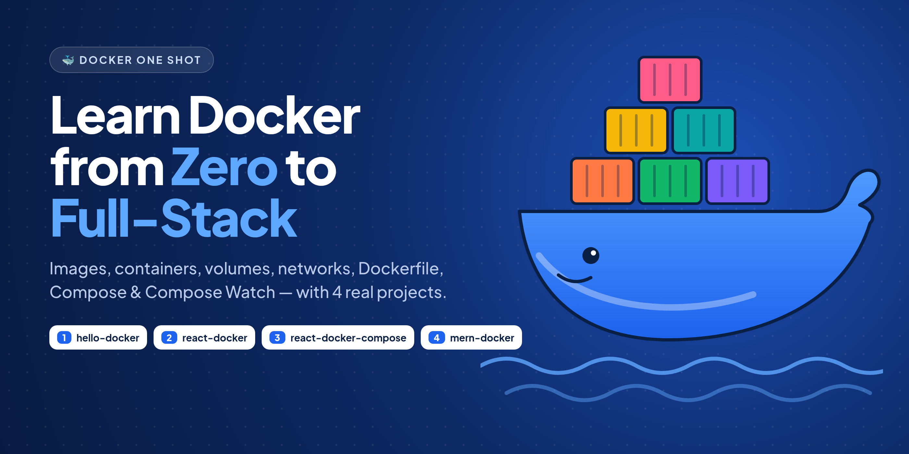
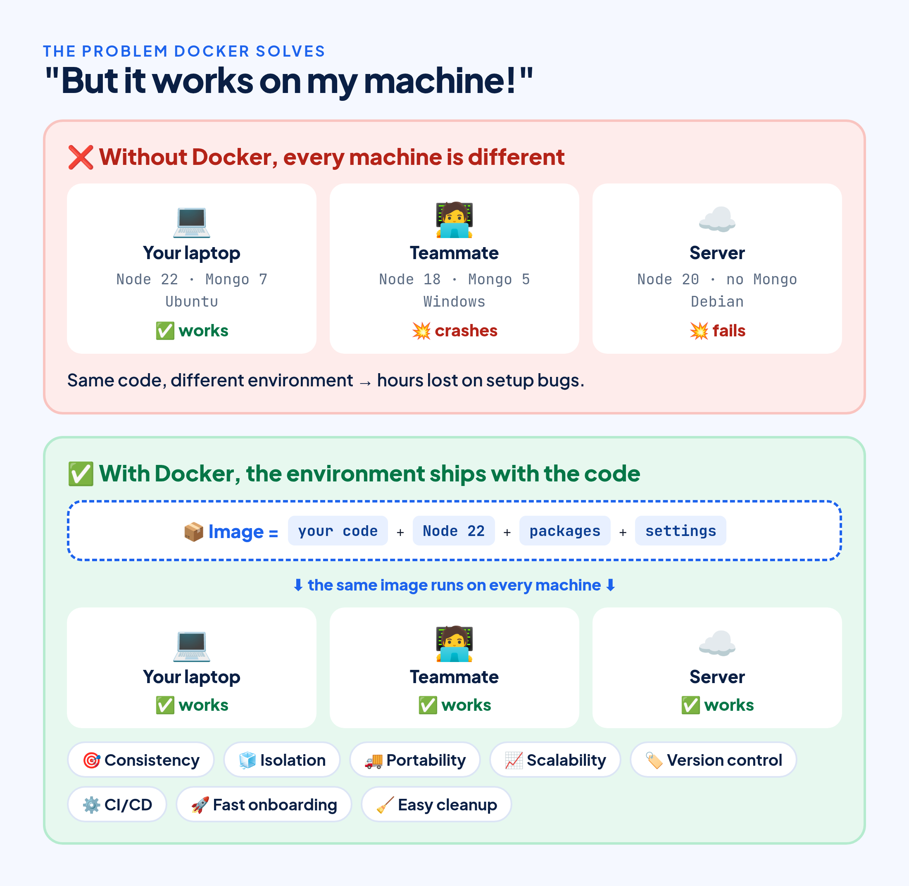
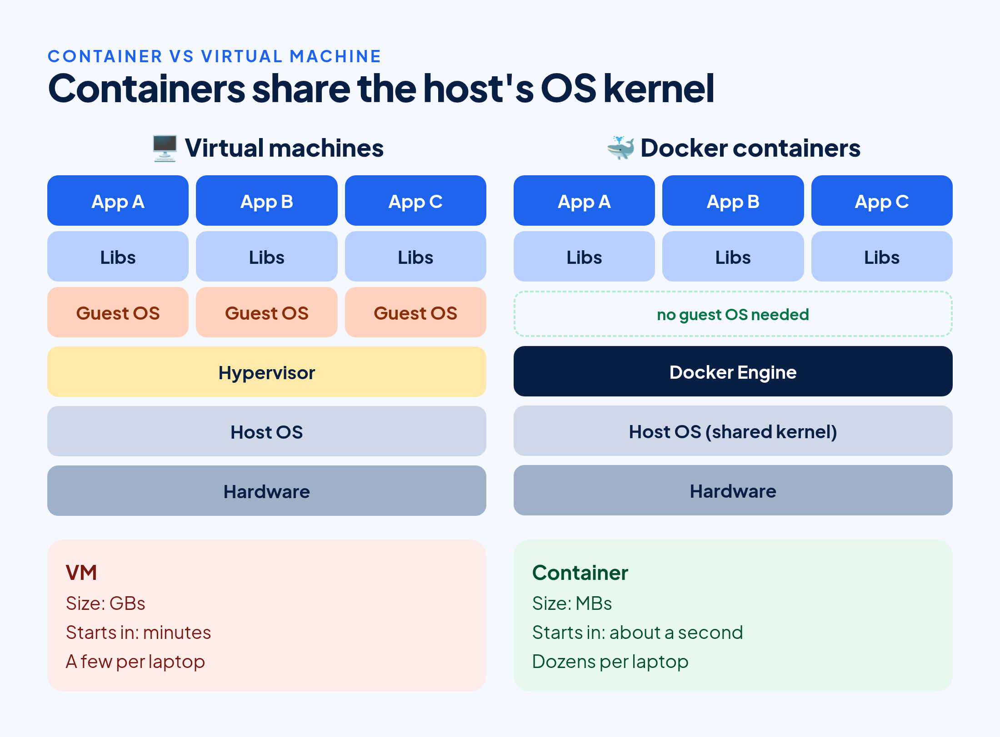
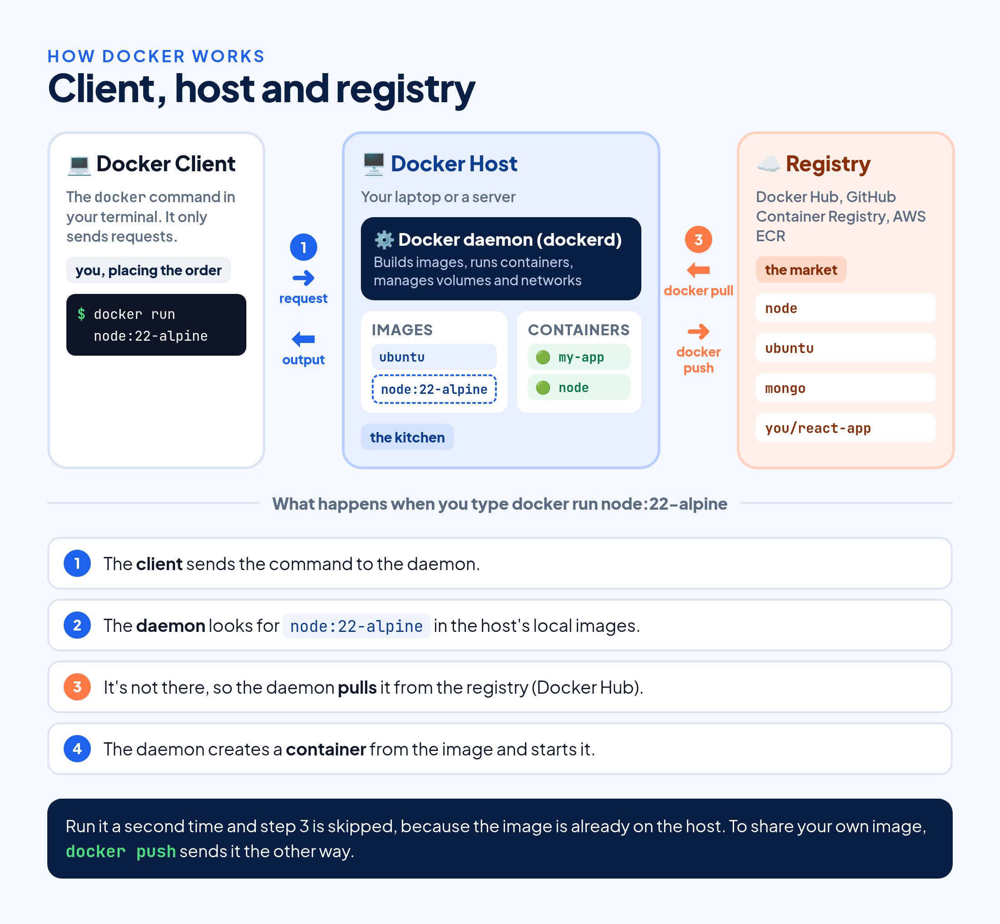
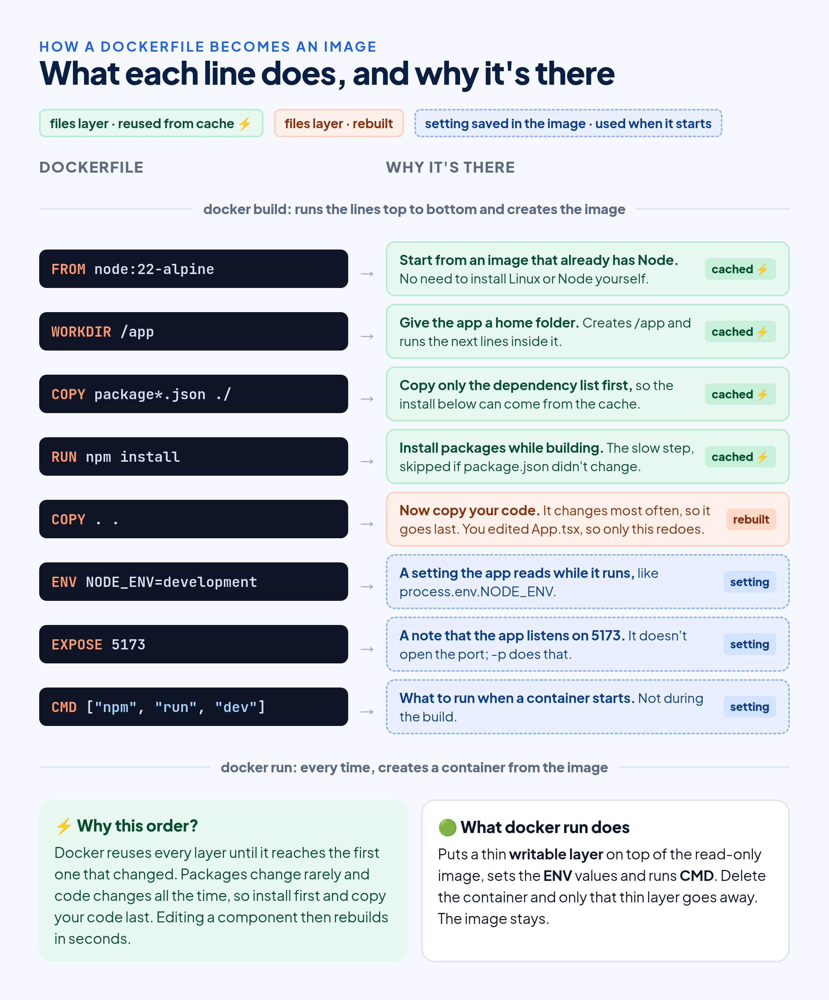
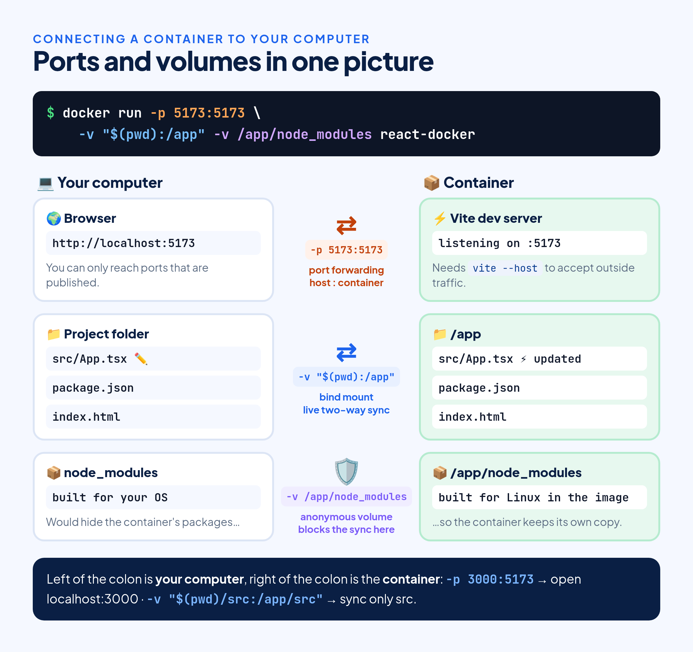
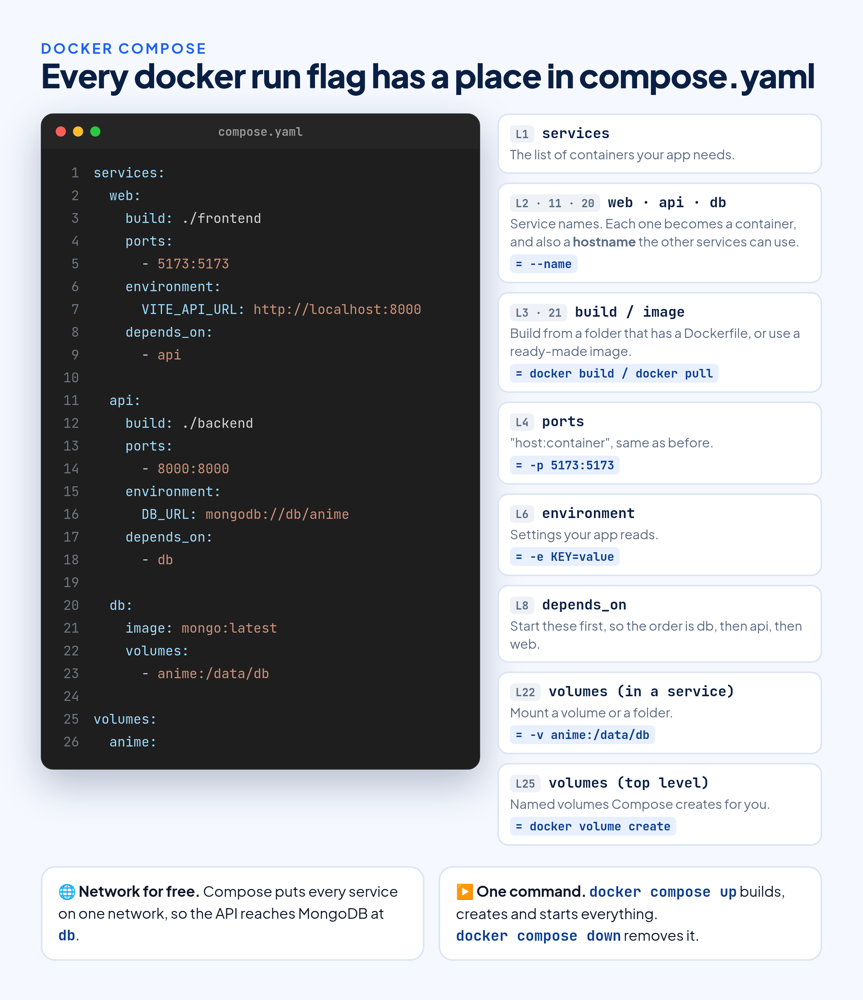
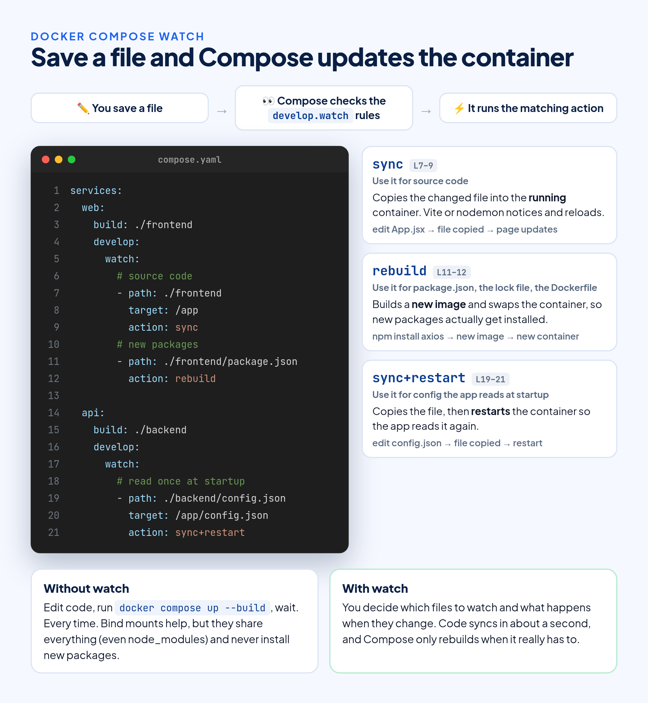
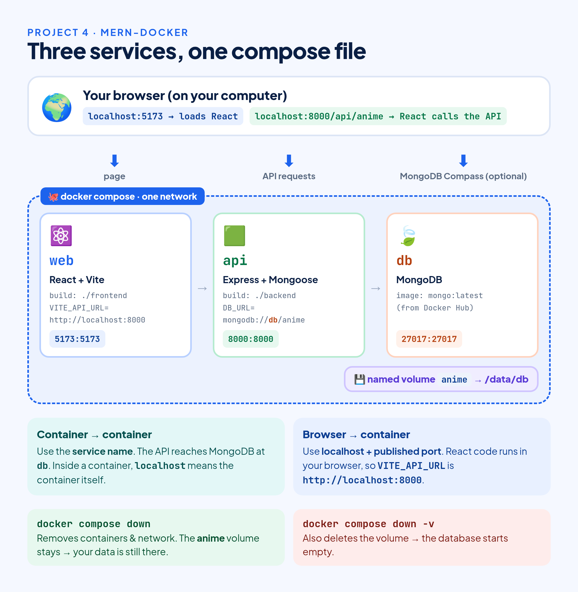

# Docker One Shot: Learn Docker from Zero to Full-Stack



You clone a project, follow the README, and still lose an afternoon to "wrong Node version" or "MongoDB isn't installed". Docker exists to end that.

This guide takes you from zero to running a full-stack app in containers. First you learn the ideas in plain words. Then you build four projects, one step at a time. You don't need any Docker experience. If you can run `npm install`, you can follow along.

All the code is in one repo: **https://github.com/Tanvirulislam345/docker-course**

## Table of Contents

1. Why should you use Docker?
2. Core concepts: image, container, volume, network
3. How Docker works: client, host and registry
4. How a Dockerfile becomes an image
5. Project 1: hello-docker
6. Project 2: react-docker, step by step
7. Docker Compose and Compose Watch
8. Project 3: react-docker-compose
9. Project 4: mern-docker (full stack)
10. Troubleshooting
11. Official JavaScript samples from Docker
12. Cheat sheet and what's next

**Before you start**, install [Docker Desktop](https://docs.docker.com/get-docker/) (Windows/Mac) or Docker Engine (Linux), and [Git](https://git-scm.com/). Docker Compose comes with Docker. Check both:

```bash
docker --version
docker compose version
```

---

## 1. Why should you use Docker?

Think about shipping before the 1950s. Every ship, truck and train carried cargo differently. Sacks, barrels and crates were loaded by hand, and every port had its own way of doing it. Then someone had a simple idea: put everything in one standard steel box. A crane in Chittagong and a crane in Rotterdam lift the same box the same way. Nobody cares what's inside.

Docker is that steel box for software.

Here's the problem it fixes. Three developers work on one project. I have Node 22 and MongoDB 7 on Ubuntu, and the app works. My teammate has Node 18 on Windows, and it crashes. The server has Node 20 and no MongoDB, so the deployment fails. The code is the same in all three places. The environment isn't.

With Docker you don't ship only your code. You ship your code together with the exact Node version, the packages and the settings it needs. That bundle is called an **image**, and it runs the same way on any machine that has Docker.



### So when does it actually help?

The first win is the obvious one: your laptop, your teammate's laptop, the test server and production all run the same image. If it works on one, it works on the others.

It also keeps projects out of each other's way. I have an old project stuck on Node 18 and a new one on Node 24. Without Docker I'd be switching versions all day with nvm. With Docker each project carries its own Node, and both run side by side.

New people on the team get going faster. Instead of a ten-step setup guide that's always slightly out of date, they clone the repo and run one command.

You can try tools without installing them. Need PostgreSQL or Redis for an afternoon? Start it in a container, use it, delete it. Nothing stays behind on your system.

And deploying gets boring, in a good way. Your CI pipeline builds an image, tags it `my-app:1.2` and pushes it. The server pulls that exact image. If the release is bad, you run `my-app:1.1` again.

### Containers are not virtual machines

A virtual machine carries a whole operating system, so it's gigabytes in size and takes minutes to boot. A container shares the host's OS kernel and only packs your app and its libraries. It's megabytes in size and starts in about a second.



---

## 2. Core concepts: image, container, volume, network

Four words cover most of Docker. I'll explain each one with a lunch box, because that's honestly the easiest way I know to think about it. You'll use every one of them for real in the projects, so here I keep the commands to a minimum.

### Image

Imagine your mother packs a lunch box in the morning: rice, curry, a spoon, everything you need. Once it's packed and closed, nobody changes it. You can make ten copies of that same lunch box and each one is identical.

An **image** is that packed box. It holds a small Linux base, a runtime like Node.js, your code and its libraries, plus the command that starts the app. It's read-only. You either build your own from a Dockerfile (section 4) or download a ready-made one from Docker Hub.

```bash
docker pull node:22-alpine   # download an image
docker images                # list the images on your machine
```

`node:22-alpine` is the image `node` with the tag `22-alpine`, which means Node 22 on Alpine, a tiny Linux. If you leave the tag out, Docker uses `latest`.

### Container

Opening the box and eating the lunch is the **container**. It's a running copy of an image. You can start many containers from one image, and each one is isolated from the others, the same way two people eating the same lunch don't share a plate. Throwing away a container doesn't touch the image.

```bash
docker run -it ubuntu   # start a container and get a shell inside it
docker ps -a            # list containers, including stopped ones
```

Run the first command and you're inside Ubuntu, even if your laptop runs Windows or macOS. Type `exit` to leave.

If you know object-oriented code: the image is a class, the container is an object.

### Volume

Whatever you leave in the lunch box goes in the bin with it. Same with containers: anything a container writes inside itself is gone when you delete the container. For a database, that's a disaster.

A **volume** is like a locker outside the box. The container keeps its data there, and the locker stays when the container is gone. The next container can open the same locker.

```bash
docker volume create my-data
docker run -v my-data:/data ubuntu   # mount the volume at /data inside the container
```

### Network

Containers are isolated, so how does your API talk to its database? You connect them to the same **network**, a bit like an office intercom. Everyone on it can call the others by name instead of by IP address.

```bash
docker network create my-net
docker run --network my-net --name db mongo   # other containers on my-net can reach it at "db"
```

You'll rarely create networks by hand. Docker Compose does it for you in Project 4.

That's all four. The rest of the commands show up in the projects when you need them, and every one of them is in the [cheat sheet](https://github.com/Tanvirulislam345/docker-course/blob/main/docker-commands-cheatsheet.md).

---

## 3. How Docker works: client, host and registry

When you type a `docker` command, three separate parts are involved. A restaurant is a good way to picture them.

### Docker client: you placing the order

The **client** is the `docker` command in your terminal. It doesn't build or run anything itself. Like a customer giving an order to the waiter, it only sends your request (`docker build`, `docker run`, `docker pull`) to the daemon and shows you what comes back.

### Docker host: the kitchen

The **host** is the machine where Docker runs, your laptop or a server. On it lives the **Docker daemon** (`dockerd`), which is the kitchen. It does all the real work: building images, creating and starting containers, setting up volumes and networks. It also keeps the images you've already downloaded or built, like a fridge full of ingredients. Docker Desktop starts the daemon for you. On Linux it runs as a system service.

### Registry: the market

A **registry** is where images are stored and shared. When the kitchen is missing an ingredient, it goes to the market. **Docker Hub** is the default registry. GitHub Container Registry and AWS ECR are others, and companies often run a private one. `docker pull` downloads an image from a registry and `docker push` uploads yours.

### Putting it together: what happens on `docker run`

Say you type `docker run node:22-alpine` for the first time:

1. The client sends the command to the daemon.
2. The daemon checks whether `node:22-alpine` is already on the host.
3. It isn't, so the daemon pulls it from Docker Hub.
4. The daemon creates a container from the image and starts it.

Run the same command again and step 3 is skipped, because the image is already on your machine. That's why the second run is so much faster.



---

## 4. How a Dockerfile becomes an image

If the image is the packed lunch box, the **Dockerfile** is the recipe. It's a plain text file, named exactly `Dockerfile`, with one instruction per line. `docker build` reads it from top to bottom and follows each step.

Every instruction adds a **layer** to the image, like stacking food in the box one compartment at a time. Docker remembers (caches) each layer. When you build again, it reuses every layer up to the first one that changed, and redoes everything after it.

That's why the order of the lines matters. Your dependencies change rarely, and your code changes all the time. So a good Dockerfile copies `package.json` and runs `npm install` first, and copies the rest of your code last. Edit a component, rebuild, and Docker skips the slow install step completely.

Here's a typical Node Dockerfile, with what each line is for:



Two pairs that confuse almost every beginner (they confused me too):

- **RUN vs CMD.** `RUN npm install` happens once, while the image is being built. `CMD npm run dev` happens every time a container starts.
- **ARG vs ENV.** `ARG` is a variable that only exists during the build, and you can override it with `--build-arg`. `ENV` is still there when the app runs.

You'll also see `USER` in the React and MERN Dockerfiles. It switches to a normal user, so the app doesn't run as `root`. That's a cheap safety habit in case the app ever gets hacked.

### .dockerignore

This works like `.gitignore`, but for builds: it keeps files out of the image. Our React projects ignore `node_modules/`. Your local packages are built for your OS, while the image needs packages built for Linux, so `npm install` runs inside the image instead.

```
node_modules/
```

---

## 5. Project 1: hello-docker

The smallest app I could think of: Node.js prints one line.

```bash
git clone https://github.com/Tanvirulislam345/docker-course.git
cd docker-course/hello-docker
```

`app.js`:

```js
console.log("Hello, Docker!");
```

`Dockerfile`:

```dockerfile
ARG NODE_VERSION=22.21.1

FROM node:${NODE_VERSION}-alpine

WORKDIR /app

COPY . .

CMD ["node", "app.js"]
```

Line by line:

- `ARG NODE_VERSION=22.21.1` sets the default Node version, which you can change at build time.
- `FROM node:${NODE_VERSION}-alpine` starts from the official Node image on Alpine Linux.
- `WORKDIR /app` makes `/app` the working folder.
- `COPY . .` copies the project (just `app.js`) into `/app`.
- `CMD ["node", "app.js"]` runs the app when the container starts.

**Build the image:**

```bash
docker build -t hello-docker .
```

`-t hello-docker` gives the image a name (a tag). The final `.` is the **build context**: the folder Docker sends to the build, and where it looks for the Dockerfile.

**Run it:**

```bash
docker run --rm hello-docker
```

```
Hello, Docker!
```

`--rm` deletes the container as soon as it stops. This app prints one line and exits, so there's nothing worth keeping.

That's your first container. Notice that you never installed Node.js. It came inside the image.

**Try another Node version** without touching the Dockerfile, thanks to `ARG`:

```bash
docker build --build-arg NODE_VERSION=20 -t hello-docker .
docker run --rm hello-docker
```

**Clean up:**

```bash
docker rmi hello-docker
```

---

## 6. Project 2: react-docker, step by step

Now a real frontend: React 19 + TypeScript + Vite. This one is a web server, so you'll run into **ports** and **volumes**.

```bash
cd ../react-docker
```

### Important: add `--host` to the dev script

Open `package.json` and make sure the `dev` script is `vite --host`:

```json
"scripts": {
  "dev": "vite --host",
  "build": "tsc -b && vite build",
  "lint": "eslint .",
  "preview": "vite preview"
}
```

> **Why?** By default Vite only listens on `localhost` *inside the container*. Your browser's requests come from outside the container, so Vite ignores them and the page never loads. `--host` makes Vite listen on all network interfaces, so Docker can forward your requests to it. In your own projects, change `"dev": "vite"` to `"dev": "vite --host"` (or set `server: { host: true }` in the Vite config). This repo already has it.

### The Dockerfile

The repo version has a comment on every line. Without comments:

```dockerfile
ARG NODE_VERSION=22.21.1
FROM node:${NODE_VERSION}-alpine

RUN addgroup app && adduser -S -G app app
USER app

WORKDIR /app
COPY package*.json ./

USER root
RUN chown -R app:app .
USER app

RUN npm install
COPY . .

EXPOSE 5173
CMD ["npm", "run", "dev"]
```

In plain words:

1. Start from Node 22 on Alpine.
2. Create a normal user called `app` and switch to it, so the app doesn't run as `root`.
3. Work in `/app` and copy only `package.json` and `package-lock.json` first. This is the cache trick from section 4.
4. `WORKDIR` and `COPY` create files owned by `root`, so the `app` user can't write there and `npm install` would fail with `EACCES: permission denied`. So we switch to `root` for a moment, hand `/app` over to `app` with `chown`, and switch back.
5. Install dependencies inside the image, then copy the rest of the code.
6. Note that the app uses port 5173, and start the Vite dev server.

Now let's run it, adding one flag at a time so you can see what each one does.

### Step 1: build the image

```bash
docker build -t react-docker .
```

The first build runs `npm install` and takes a minute. Later builds reuse the cache.

### Step 2: run it

```bash
docker run react-docker
```

Vite says it's ready at `http://localhost:5173`, but if you open that in your browser, nothing loads. The container has its own network. Port 5173 is open inside it, but nothing connects it to your computer. Press `Ctrl + C`.

### Step 3: map the port with `-p`

```bash
docker run -p 5173:5173 react-docker
```

Open **http://localhost:5173** and the app loads. `-p HOST:CONTAINER` forwards a port on your computer to a port in the container. The right side has to match where the app listens (5173). The left side can be any free port: with `-p 3000:5173` you'd open http://localhost:3000.

### Step 4: run in the background with `-d` and `--name`

```bash
docker run -d -p 5173:5173 --name react-app react-docker
```

`-d` (detached) gives you your terminal back, and `--name` gives the container a name you can remember. To manage it:

```bash
docker ps                 # is it running?
docker logs react-app     # what did it print?
docker logs -f react-app  # follow logs live (Ctrl + C to exit)
docker stop react-app     # stop it
docker rm react-app       # remove it
```

### Step 5: sync your code with `-v`

Edit `src/App.tsx` and refresh the browser. Nothing changes. Your code was copied into the image at build time, so the container never sees your edits. Rebuilding after every change would get old fast.

Mount your project folder into the container instead:

```bash
docker run -p 5173:5173 -v "$(pwd):/app" react-docker
```

`-v "$(pwd):/app"` is a **bind mount**: the current folder shows up at `/app` in the container and stays in sync. But now the container crashes:

```
Error: Cannot find native binding. ...
  cause: Error: Cannot find module '@rolldown/binding-linux-x64-musl'
```

The mount replaced the whole `/app` folder, including `node_modules`. The Linux packages installed in the image are now hidden behind your local folder, which was built for your OS (or doesn't exist, if you never ran `npm install`).

### Step 6: protect node_modules

```bash
docker run -p 5173:5173 -v "$(pwd):/app" -v /app/node_modules react-docker
```

The second `-v /app/node_modules` is an **anonymous volume**. It tells Docker to keep the container's own copy of that one folder. Your code syncs, and the packages stay where they are.



> **Windows:** use `${PWD}` in PowerShell or `%cd%` in Command Prompt instead of `$(pwd)`.

### Step 7: edit and refresh

Change the "Get started" heading in `src/App.tsx` and save. The browser updates by itself, because Vite's hot reload works inside Docker too. The logs show:

```
[vite] (client) hmr update /src/App.tsx
```

If your edits don't show up (it happens on some Windows/Mac setups), turn on polling in `vite.config.ts`: `server: { watch: { usePolling: true } }`.

### Step 8: auto-cleanup with `--rm`

```bash
docker run --rm -d --name react-app -p 5173:5173 \
  -v "$(pwd):/app" -v /app/node_modules react-docker
```

`--rm` deletes the container when it stops, so `docker stop react-app` is all the cleanup you need.

The command works. But look at it: five flags you have to remember, type every time, and explain in a README. Now imagine a frontend, a backend and a database. This is where Docker Compose comes in.

---

## 7. Docker Compose and Compose Watch

**Docker Compose** lets you describe your containers in one YAML file, `compose.yaml`, and start all of them with `docker compose up`.

That long command from Project 2 gets written down once, saved in Git and shared with the team. A frontend, a backend and a database can live in the same file. Compose also creates a network for you, so services reach each other by their service name, and `depends_on` makes sure the database starts before the API. Day to day you use the same few commands (`up`, `down`, `logs`, `ps`) for the whole app.

Every `docker run` flag you learned has a place in `compose.yaml`:



The commands I use every day:

```bash
docker compose up            # build if needed, create and start everything
docker compose up --build    # rebuild images first
docker compose up -d         # run in the background
docker compose ps            # list this project's containers
docker compose logs -f web   # follow one service's logs
docker compose stop          # stop, keep the containers
docker compose down          # stop and remove containers and network
docker compose down -v       # also delete volumes (deletes database data!)
```

### Compose Watch

Even with Compose, the image holds a copy of your code. Change a file and you have to run `docker compose up --build` and wait. Bind mounts (Project 2) help, but they share everything, so you need the `node_modules` trick. They can also be slow on Mac and Windows, and they never install a package you just added.

`docker compose watch` fixes this. In a `develop.watch` section you list which files to watch and what Compose should do when they change. There are three actions:

- **`sync`** copies the changed files into the running container. Use it for source code, and let Vite or nodemon reload it.
- **`rebuild`** builds a new image and replaces the container. Use it for `package.json`, the lock file and the Dockerfile.
- **`sync+restart`** copies the files and then restarts the container. Use it for config files that are only read at startup.



Compose Watch needs Docker Compose v2.22 or newer. You'll use it in Project 4.

---

## 8. Project 3: react-docker-compose

Same React app as Project 2, same Dockerfile, same `vite --host` dev script. This time we run it with Compose.

```bash
cd ../react-docker-compose
```

`compose.yaml`:

```yaml
services:
  web:
    build:
      context: .
    ports:
      - 5173:5173
    volumes:
      - .:/app
      - /app/node_modules
```

It's the long Project 2 command, written as a file:

- `web` is one service, which means one container.
- `build: context: .` builds from the Dockerfile in this folder, like `docker build .`.
- `ports: - 5173:5173` is the same as `-p 5173:5173`.
- `volumes: - .:/app` is the same as `-v "$(pwd):/app"`.
- `volumes: - /app/node_modules` is the same as `-v /app/node_modules`.

**Start it:**

```bash
docker compose up --build
```

Open **http://localhost:5173** and edit `src/App.tsx`. The page updates live, thanks to the volumes. To run it in the background, add `-d`:

```bash
docker compose up -d --build
docker compose ps
docker compose logs -f web
```

**Stop and clean up:**

```bash
docker compose down
```

That one command removes the container and the network Compose created.

> **Added an npm package and it's "missing" in the container?** The `/app/node_modules` volume still holds the old packages. Run `docker compose down -v`, then `docker compose up --build`.

---

## 9. Project 4: mern-docker (full stack)

An anime sharing app built with MongoDB, Express, React and Node.js. Three containers, one command.

```bash
cd ../mern-docker
```



- **web** is the React + Vite frontend from `./frontend`, on port 5173. Home (`/`) lists anime and Share (`/create`) adds one.
- **api** is the Express + Mongoose backend from `./backend`, on port 8000, with `GET` and `POST` on `/api/anime`.
- **db** is MongoDB from the official `mongo:latest` image, on port 27017, with its data in the named volume `anime`.

### The Dockerfiles

`backend/Dockerfile` and `frontend/Dockerfile` follow the Project 2 pattern, with two differences. They use `npm ci` instead of `npm install`, which installs exactly the versions in `package-lock.json` and is faster and more predictable for builds. And the backend exposes port 8000 and starts with `npm start`, which runs `nodemon`, so the server restarts when files change.

### compose.yaml

The repo version is fully commented. Without comments:

```yaml
services:
  web:
    depends_on:
      - api
    build: ./frontend
    ports:
      - 5173:5173
    environment:
      VITE_API_URL: http://localhost:8000
    develop:
      watch:
        - path: ./frontend/package.json
          action: rebuild
        - path: ./frontend/package-lock.json
          action: rebuild
        - path: ./frontend
          target: /app
          action: sync

  api:
    depends_on:
      - db
    build: ./backend
    ports:
      - 8000:8000
    environment:
      DB_URL: mongodb://db/anime
    develop:
      watch:
        - path: ./backend/package.json
          action: rebuild
        - path: ./backend/package-lock.json
          action: rebuild
        - path: ./backend
          target: /app
          action: sync

  db:
    image: mongo:latest
    ports:
      - 27017:27017
    volumes:
      - anime:/data/db

volumes:
  anime:
```

Two lines here tripped me up the first time:

- **`DB_URL: mongodb://db/anime`. Why not `localhost`?** The API runs inside a container, and inside a container `localhost` means that container itself. On the Compose network every service name is also a hostname, so `db` points to the MongoDB container.
- **`VITE_API_URL: http://localhost:8000`. So why `localhost` here?** Because the React code doesn't run in the `web` container. It runs in your browser, outside Docker, where the API is reachable on the published port 8000.

A simple way to remember it: from one container to another, use the service name. From the browser to a container, use localhost and the published port.

### Start the stack

```bash
docker compose up --build
```

Compose builds two images, pulls MongoDB, creates the network and the `anime` volume, then starts `db`, `api` and `web` in that order (because of `depends_on`). Open:

- Frontend: **http://localhost:5173**
- API: **http://localhost:8000/api/anime**

Check the API logs (in a second terminal, or start with `-d`):

```bash
docker compose logs api
```

```
api-1  | server listening on port 8000
api-1  | Successfully connected to database
```

The API found MongoDB just by its service name.

### Add some data

Use the Share page, or call the API directly:

```bash
curl -X POST http://localhost:8000/api/anime \
  -H "Content-Type: application/json" \
  -d '{"title": "Naruto", "description": "A ninja story"}'

curl http://localhost:8000/api/anime
```

```
[{"_id":"6ace2542f8bee954078eba94","title":"Naruto","description":"A ninja story","__v":0}]
```

### Does the data survive?

```bash
docker compose down
docker compose up -d
curl http://localhost:8000/api/anime
```

Naruto is still there, because MongoDB's files live in the `anime` volume and not in the container. Now try it with `-v`:

```bash
docker compose down -v
docker compose up -d
curl http://localhost:8000/api/anime
```

```
[]
```

Empty. `-v` deleted the volume and every record in it. Use `down` day to day, and `down -v` only when you actually want a fresh database.

### Live development with Compose Watch

```bash
docker compose down
docker compose watch
```

Open `backend/index.js`, change `res.send("Hello World!")` to `res.send("Hello from Docker Compose Watch!")` and save. Compose prints:

```
Syncing service "api" after 1 changes were detected
```

nodemon restarts the server inside the container, and `curl http://localhost:8000/` returns the new text. You didn't rebuild or restart anything yourself. Edit a React component and the browser updates the same way. Add a package and Compose rebuilds the image for you, because `package.json` is set to `rebuild`.

Two settings in the frontend's `vite.config.js` make this work:

```js
server: {
  host: true,                    // same job as "vite --host"
  port: 5173,
  watch: { usePolling: true },   // notice files synced in by compose watch
},
```

Press `Ctrl + C` to stop watching, then run `docker compose down`.

**Bonus:** want to run the Node apps on your own machine but skip installing MongoDB? Start only the database with `docker compose up -d db`. It's available at `mongodb://localhost:27017/anime`.

---

## 10. Troubleshooting

- **`port is already allocated`**: another program is using that port. Map a different host port, e.g. `-p 3000:5173`, and open http://localhost:3000.
- **The page doesn't load, but the logs say "ready"**: Vite is only listening inside the container. Use `"dev": "vite --host"`.
- **`EACCES: permission denied`**: the non-root `app` user can't write to `/app`. Keep `RUN chown -R app:app .` before `npm install` / `npm ci`.
- **`Cannot find native binding` or `vite: not found`**: a bind mount hid the container's `node_modules`. Add `-v /app/node_modules`.
- **A new npm package is missing in the container**: run `docker compose down -v`, then `docker compose up --build`.
- **`database connection failed. exiting now...`**: the API can't reach MongoDB. Check `docker compose ps` and make sure `DB_URL` is `mongodb://db/anime`, then run `docker compose restart api`.
- **Edits don't show up in mern-docker**: `docker compose up` doesn't sync files. Use `docker compose watch`.
- **`Cannot connect to the Docker daemon`**: Docker isn't running. Start Docker Desktop, or run `sudo systemctl start docker` on Linux.

---

## 11. Official JavaScript samples from Docker

Once our four projects make sense, the best next step is reading other people's `compose.yaml` files. Docker keeps a list of ready-to-run JavaScript projects on its [JavaScript samples page](https://docs.docker.com/reference/samples/javascript/). Each one is a small repo with a Dockerfile and a Compose file, and most of them start with `docker compose up`.

The ones I'd look at first, roughly in order:

- **[React / Express / MongoDB](https://github.com/docker/awesome-compose/tree/master/react-express-mongodb)**: almost the same stack as Project 4. Put it next to our `mern-docker` and compare the two files.
- **[React / Express / MySQL](https://github.com/docker/awesome-compose/tree/master/react-express-mysql)**: the same idea with MySQL instead of MongoDB, so you can see what changes when the database changes.
- **[React / NGINX](https://github.com/docker/awesome-compose/tree/master/react-nginx)**: builds the React app and serves the static files with Nginx. This is how a React frontend usually runs in production, instead of the Vite dev server we used.
- **[NGINX / Node.js / Redis](https://github.com/docker/awesome-compose/tree/master/nginx-nodejs-redis)**: a Node.js app behind an Nginx proxy, with Redis as the database. It's a good look at how several containers sit behind one entry point.
- **[VueJS](https://github.com/docker/awesome-compose/tree/master/vuejs)**: a single Vue.js app, if Vue is more your thing than React.
- **[slack-clone-docker](https://github.com/dockersamples/slack-clone-docker)**: a Slack clone on the MERN stack. It's bigger than our anime app, which makes it good practice for reading a real project.

The page also has a few mixed-stack samples: React with a [Spring](https://github.com/docker/awesome-compose/tree/master/react-java-mysql) or [Rust](https://github.com/docker/awesome-compose/tree/master/react-rust-postgres) backend, the [AtSea shop](https://github.com/dockersamples/atsea-sample-shop-app) (React + Spring Boot), and a [Docker Swarm visualizer](https://github.com/dockersamples/docker-swarm-visualizer) written in Node.js.

To try one, clone the repo, `cd` into the sample's folder and run:

```bash
docker compose up -d
```

Read the `compose.yaml` before you run it. By now you should recognize almost every line.

---

## 12. Cheat sheet and what's next

Every command from this guide and plenty more, grouped by image, container, volume and network, plus builds, Compose, registry and cleanup, is on one page:

**[Docker Commands Cheat Sheet](https://github.com/Tanvirulislam345/docker-course/blob/main/docker-commands-cheatsheet.md)**

### What you learned

- Why Docker is worth using, and the problems it takes off your plate.
- The four building blocks: images, containers, volumes and networks.
- How the client, the host (with its daemon) and the registry work together.
- How a Dockerfile becomes an image, and why the order of instructions matters for caching.
- The `docker run` flags you'll use most: `-p`, `-d`, `--name`, `-v`, `--rm`.
- Docker Compose for multi-container apps, and Compose Watch for a fast dev loop.
- A full MERN stack running with one command.

### Where to go next

- **Multi-stage builds.** Compile React to static files and serve them from a tiny production image.
- **Push to Docker Hub.** Use `docker tag` and `docker push`, then `docker pull` on a server.
- **CI/CD.** Build and push images automatically with GitHub Actions.
- **Kubernetes.** Run and scale containers across many machines.

The code for everything here: **https://github.com/Tanvirulislam345/docker-course**

If this guide helped you, leave a clap, star the repo, and send it to the next person who tells you "but it works on my machine".
